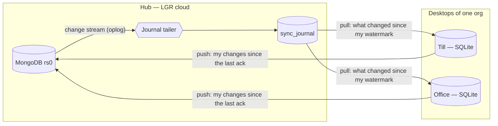
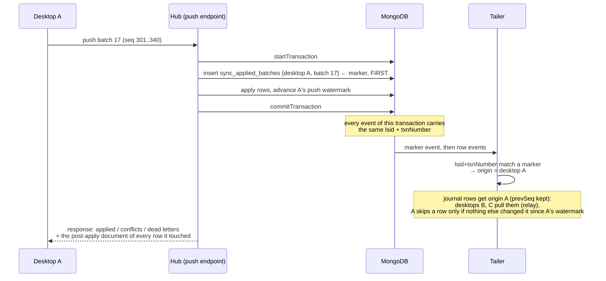

# LGR Sync Architecture — hub ↔ desktop

> **Status: target architecture.** Specified by [FR-16](../fr/FR-16-local-mode-sync-engine.md) ([gjovanov/lgr#59](https://github.com/gjovanov/lgr/issues/59), epic [#56](https://github.com/gjovanov/lgr/issues/56))
> (registry: [FR-15](../fr/FR-15-desktop-registration.md), Sync page:
> [FR-17](../fr/FR-17-sync-page.md), tests: [FR-18](../fr/FR-18-desktop-tests-field-automation.md)).
> **Nothing below is implemented yet.** The mechanism is modelled on the PCON+ hub/spoke
> engine (`g-rox/pcon` → `docs/Sync_Architecture.md`, branch `dev`). MongoDB change streams
> over the oplog take the place of SQL Server CDC on the hub. §12 lists what the 2026-03 LAN
> prototype in `packages/sync` did, and why each piece of it is replaced.

This document covers how data moves between the LGR cloud and the LGR Desktop installations
registered to its orgs. It also names the moving parts, and says what to look at when something
goes wrong. The cloud is one MongoDB replica set serving many orgs.

The first section is deliberately non-technical. The reference sections after it assume you know
MongoDB and SQLite.

---

## 1. The model in plain language

There is **one hub** and **many desktops**.

- The **hub** is the LGR cloud: the `lgr` API and its MongoDB replica set (`rs0`). It serves
  every org. The web app writes to it, and so do the import skills and the ops scripts.
- A **desktop** is one LGR Desktop installation, registered to **exactly one org** (FR-15). It
  keeps a local SQLite copy of the part of its org's data that it needs, and it keeps working
  when the hub is unreachable. That is **local mode**. In **server mode** the same desktop simply
  opens the cloud app (FR-14).

Both sides are written to, so the sync is **two-way**. A change made on the hub appears on every
desktop that needs it. A change made on a desktop appears on the hub, and from there on the
org's other desktops. **Nothing ever crosses an org boundary.** A desktop only ever reads and
writes rows carrying its own `orgId`.



Each desktop runs its half in its sidecar. A **cycle** is two steps: first push whatever
changed locally, then pull whatever changed on the hub. A cycle starts when the hub pokes
the desktop over its WebSocket (§5.1). Without a socket it starts on an adaptive timer of 5 to
60 s. The hub's half runs inside the `lgr` API process: a single journal tailer, plus the
pull, push and reconcile endpoints.

### The three directions

Every row in the run log carries a direction. The three are not interchangeable.

| Code | Name | What it is |
|------|------|------------|
| `hd` | hub → desktop (**pull**) | Incremental. Reads the org's journal from the desktop's watermark and applies the changes to SQLite. |
| `dh` | desktop → hub (**push**) | Incremental. Sends the desktop's captured changes and applies them to MongoDB, one transaction per batch. |
| `rc` | **reconcile** | Bidirectional **state-based** repair. It is *not* the initial load. |

**Reconcile compares the two sides as they are now**, instead of replaying a change feed. It
then repairs the differences in whichever direction the evidence points. It runs in these cases:

- a desktop is restored from an archive,
- a desktop's database turns up on another machine,
- a desktop falls behind the journal's tombstone retention,
- the hub's journal loses continuity (§11).

It is expensive; the incremental directions are the normal case. The first load of a new desktop
is just a pull from watermark `0`, because the journal indexes every synced document of the org
(§2.1).

### What to look at when something is wrong

Each question maps to a panel on the org Sync page (FR-17) or the sys-admin engine page.

1. **Is the engine alive?** The tailer writes a heartbeat every 5 s, whether or not anything
   changed. An org with nothing to do produces no run-log rows at all, so without the heartbeat
   "idle" and "dead" look the same.
2. **Is the desktop offline, paused, revoked or out of date?** Check the Desktops table. Pause
   and revoke are persisted, so both survive restarts on both sides.
3. **Are rows failing to apply?** Check **dead letters**. These are individual changes the hub
   (or the desktop) could not apply. They are parked so that the rest of the batch still went
   through.
4. **Are both sides fighting over the same field?** Check **conflicts**. Every one is logged
   with both values and the winner. None is resolved silently.
5. **Is a desktop waiting for a reconcile?** A restore, a clone, a desktop beyond retention or a
   journal-epoch change sets `reconcileRequired`. The row says which.
6. **Has the schema drifted?** The **drift** panel compares what each desktop's sync metadata
   version expects against what the hub publishes.

---

## 2. Change capture

The two sides use different mechanisms, and the difference matters.

| | Hub | Desktop |
|---|---|---|
| Mechanism | **Change stream** over the replica-set oplog, tailed by one process into `sync_journal` | **SQLite triggers** into `_changes` |
| Records | Which document changed, how (upsert/delete/evict), who caused it (origin), its route keys | Which row, which columns, old and new values, HLC time, acting user |
| Ordering | Per-org monotonic `seq`, assigned in change-stream (commit) order | `_changes.seq` (AUTOINCREMENT) |
| Values | **Read at pull time** from the live collection | Carried in the change (`old` = base, `new` = value) |
| Retention | Document rows: as long as the document exists. Tombstones: `SYNC_TOMBSTONE_DAYS` (default 180) | Until the hub acknowledges the batch, then 7 days for diagnostics |

### 2.1 Hub: one change stream, one journal

Two alternatives were measured or counted, and both are rejected:

- **An `updatedAt` query.** FR-13 §3.4 measured it on regal-pz: a 7-day `updatedAt` window
  carries **46,288 documents, 81 % of the org**. The reason is that `assign-din-tags`,
  `backfill-*` and `seed-products --no-clean` rewrite the whole catalog on purpose. It also
  cannot see deletes at all.
- **Mongoose middleware.** Middleware sees only the writes that go through it. On 2026-09-28
  the application and `scripts/` contained 15 `bulkWrite`, 16 `updateMany`, 8 `insertMany`,
  14 `deleteMany` and 4 raw `collection.*` write sites (tests excluded). None of them is
  reliably hooked. Add the ops scripts run in the pod, and any `mongosh` fix an operator makes by
  hand.

**The oplog sees every write, whatever issued it.** It is also already there: the production
replica set keeps a 3,544 MB oplog holding **134.8 days** of history (FR-13 §1.3).

- **The tailer.** One change stream is opened on the `lgr` database with:
  - a `$match` on the synced collections plus `sync_applied_batches`,
  - `fullDocument: 'whenAvailable'`,
  - `fullDocumentBeforeChange: 'whenAvailable'`,
  - `showExpandedEvents: true`, so that `drop`, `rename` and `create` reach the drift check.

  Every synced collection has `changeStreamPreAndPostImages` enabled. The pre-image is what lets
  a **delete** carry its `orgId` and route keys. It is also what lets an update that *moves* a
  document between scopes produce an **eviction** (§4).
- **Exactly-once into the journal.** The tailer consumes events in batches of up to 1,000 events
  or 200 ms. For each batch it runs **one** transaction that does three things:
  1. allocates a contiguous `seq` block per org (`$inc` by N on `sync_orgs.seq`),
  2. upserts the journal rows,
  3. saves the batch's last resume token on `sync_engine`.

  A crash replays at most the uncommitted batch, and the journal upsert is idempotent.

  ⚠ **A batch is cut only at a transaction boundary.** It never falls between two events that
  share `lsid` + `txnNumber`. A push transaction carries up to 501 events. If a crash or a lease
  handover resumed in the middle of one, the resumed tailer would never see that transaction's
  marker, and would journal the rest of the transaction as origin `hub`.
- **A per-document index, not a log.** `sync_journal` holds **one row per (org, collection,
  document)**, plus one row per pending eviction. The row key is `(orgId, coll, docId, lane)`,
  where `lane` is `doc` for the document's own row and `evict:<route key>` for an eviction row.

  The row carries:
  - the latest `seq`;
  - **`prevSeq`**: the row's `seq` before the latest change (§3 needs it);
  - `op`, `origin`, the route keys, and the names of the changed fields.

  It has SQL Server Change Tracking semantics, the same as PCON+'s spokes: the journal says
  *that* invoice 42 changed and *which* fields, and the values are read from the collection when
  a desktop pulls. The results:
  - A desktop that was off for a week pulls each changed document **once**, at its current
    state.
  - The journal's size is bounded by the number of documents, not by the number of writes.
- **Global collections.** A collection with no `orgId` (ExchangeRate) is journaled under the
  sentinel org `_global` and delivered to every desktop, read-only.
- **Seeding.** When sync is enabled for an org, the engine writes a journal row for every
  existing document in every synced collection. From then on the journal is the complete index
  of the org's synced documents. A new desktop's first load is therefore an ordinary pull from
  `seq 0`, and a later delete can always be routed.

  Seeding writes with `$setOnInsert` only, so a row that a live event has already written is
  never overwritten with stale route keys.
- **Singleton.** Exactly one tailer runs per deployment. It holds a lease on `sync_engine`
  (renewed every 5 s, expiring after 15 s). With `replicas: 1` and `RollingUpdate`, two pods
  overlap for a few seconds during every deploy. Without the lease, both would tail and both
  would allocate `seq`.

⚠ This is the **first** lease in the codebase. FR-11 and FR-13 both chose a unique index as
their lock, because a once-a-day claim is exactly what an index is good at. A tailer that runs
continuously is not a once-a-day claim.

### 2.2 Desktop: triggers into `_changes`

Every synced table gets `AFTER INSERT/UPDATE/DELETE` triggers. These are **generated** from the
same metadata as the table itself (§9). Each trigger writes one `_changes` row: table, row id,
op, the changed top-level fields, their old and new values, an HLC timestamp and the acting user.

Triggers are **never dropped**. Echo suppression (§3) is a condition inside the trigger. The
prototype's drop-and-reinstall approach meant a crash in the middle of an apply would leave
change capture silently switched off.

The desktop keeps a **hybrid logical clock**: `hlc = max(wall clock, last hlc + 1)`, advanced
to the hub's `clusterTime` on every pull. The HLC orders the desktop's own changes and feeds
the clock-skew warning. It never decides a conflict against the hub on its own (§7), because a
desktop clock can simply be wrong. FR-61's cloned Win11 guests boot about 3 h ahead of UTC.

---

## 3. Echo suppression and relay

The engine writes to both sides. Those writes are changes too, so without care they would be
captured and sent straight back: an infinite loop.



**On the hub** the push applier works in a Mongo transaction. Its **first** write inserts a
marker into `sync_applied_batches`. Every change event from a multi-document transaction carries
that transaction's `lsid` and `txnNumber`, so the tailer sees the marker first and then tags
every following event of the same transaction with the pushing desktop as its `origin`. Writes
with no marker are origin `hub`. That covers every web request, every other app transaction
(goods-receipt-with-update, reservation preempt) and every script.

⚠ The marker has to be the **first** statement. The tailer reads events in order, and it must
know the origin before the first row event of the transaction arrives.

**On the desktop** the pull applier runs as one SQLite transaction whose body is synchronous.
- It holds the sidecar's write mutex, which every write takes (FR-16.3). Async service code
  that awaits inside an open transaction would otherwise let another request's statements run
  inside it.
- It sets `_sync_ctx.applying = 1`, applies the rows, advances `_sync_state.hub_seq`, sets
  `applying = 0` and commits.
- Every trigger carries `WHEN (SELECT applying FROM _sync_ctx) = 0`. If the process crashes
  midway, the rollback also restores the flag.

`_sync_ctx` is a single-row table in the main schema, not a `TEMP` table. SQLite forbids
triggers in `main` from referencing `temp` objects.

**What prevents the loop, and what origin is for.** The loop is prevented on the desktop:
applying a pulled document runs under `_sync_ctx`, so it never becomes a captured change and is
never pushed back. The hub's origin attribution does two jobs, **neither of them correctness**:
- telling the Sync page who changed what;
- not re-sending a desktop its own work.

That second job is **only an optimisation, and it must be exact.** The journal collapses history
into one row per document. Suppose the hub edits X's price (seq 101) and desktop A then pushes a
note on X (seq 102). The row now says "origin A". Skipping it for A would lose the price change
for good.

So the pull skips a row for desktop A **only if `origin = A` and `prevSeq ≤ A's watermark`**,
that is, only if A's own change is the only change A has not already seen. In every other case
the row is sent, even when its latest change was A's.

**The push response closes the other gap.** The hub's apply writes more than the desktop sent:
Mongoose sets `updatedAt`, schema defaults fill fields, casting normalises values, and the
lowered-field hooks run. The push response therefore carries the **post-apply document** of
every document the batch touched. The desktop applies these under `_sync_ctx`, without moving its
watermark, and never over a field with a newer unpushed change. A skipped echo then hides
nothing, and reconcile digests match.

**Relay.** A change that came from desktop A reaches the hub with origin A. The pull sends it
to every other desktop in scope. The hub's own follow-up writes run as separate transactions with
origin `hub`, so they reach **every** desktop, A included. These follow-ups are the projections
(§5.4) and the conflict resends (§7).

---

## 4. Routing

Not every collection goes to every desktop, and not every row of a collection does either.
Each synced collection has a **class** and a **scope**. Both are declared once, in the sync
metadata (§9).

| Class | Examples | Direction | Concurrent-change policy |
|---|---|---|---|
| `master` | Product, ProductCategory, Contact, PriceList, Tag, Warehouse, Workstation, FiscalDevice, POSPaymentMethod | both | field-level; the hub wins and the conflict is logged |
| `reference` | Org (sanitised), User (sanitised), PermissionSet, ExchangeRate (global) | `hd` only | none. A desktop cannot change these. |
| `document` | Invoice (every type, incl. `cash_sale`) | both, inside the history window | field-level; `status` monotonic; `payments[]` / `statusHistory[]` / `numberHistory[]` merged by element id |
| `append` | StockMovement, POSTransaction; AuditLog (`dh` only) | inserts both ways; only the listed status transitions | none by id; a duplicate business key becomes a dead letter |
| `owned` | POSSession | `dh` while open on its desktop; `hd` after close | the owning desktop wins until the session closes |
| `derived` | StockLevel, `*Lower` mirror fields, reservation-derived quantities | `hd` only | never pushed. StockLevel: the desktop overlays its pending local effect (§5.5). `*Lower` mirrors are pulled and recomputed locally on every write with the same helper as `lowered-fields.plugin.ts`, so `buildSearchFilter` works unchanged; a pushed mirror is ignored. |
| `hub-only` | JournalEntry and all of accounting, payroll, Order / InternalOrder / Reservation, Sequence, DocFile / File, EmailLog, DigestRun, BackupRun, RestoreRun, ArchiveUnit, BackgroundTask, Notification, Invite, Code, SupplierProductAlias, DinCatalog | never leaves the hub | — |
| `desktop-only` | offline credentials, local settings, archives, keys | never leaves the desktop | — |

**Scope** decides which desktops of the org get a row. It is computed from **route keys** that
the tailer extracts from the post-image:

| Scope | Route key | A desktop receives the row when |
|---|---|---|
| `org` | `orgId` | always |
| `warehouse` | `warehouseId`, `fromWarehouseId`, `toWarehouseId` | the key intersects the desktop's assigned warehouses (FR-15) |
| `window` | the class's date (`issueDate`, `date`, `createdAt`) | the date is inside the desktop's history window (org default 90 days) |

- **Evictions.** Suppose an update moves a document out of a scope: a movement's warehouse
  changes, or a document is re-dated outside the window.
  - The tailer compares pre-image and post-image route keys and writes an **eviction** row, one
    per route-key value that was lost.
  - The pull delivers an eviction to a desktop **only if the document's current route keys are
    outside that desktop's scope.** A desktop assigned to both warehouses of an A→B move keeps
    the movement, and receives it as an upsert.
  - The desktop removes an evicted row under `_sync_ctx`, so nothing is captured and **nothing is
    pushed back**. An eviction is not a delete.
- **The desktop's own scope changes too.** An admin can assign or unassign a warehouse, or
  tighten the window (FR-15.13). No document changed, so the journal says nothing. The desktop
  runs a **scope reconcile** instead:
  - it backfills the added scope with a pull from `seq 0`, filtered to the added keys;
  - it evicts, locally and under `_sync_ctx`, the rows no longer in scope, keeping any row with
    unpushed changes or an open overlay until it has been pushed.
- **Age-out is local.** A document leaving the window only because time passed produces no
  change event. Each desktop prunes such rows itself, under `_sync_ctx`.
- **Hub-only fields never leave the hub.** The pull serialiser strips fields per collection:
  `User.password`, OAuth tokens, `Org.settings.integrations`, and anything the metadata marks
  `hubOnly`. FR-11.3 and S-14 are why this list is explicit rather than "whatever `toJSON`
  does". The `*Lower` mirrors are *not* stripped: they are `derived` (see the table).

---

## 5. Applying changes

### 5.1 Pull (hub → desktop)

`GET /api/sync/v1/pull?since=<seq>&limit=<n>` is authenticated with the desktop's access token
(FR-15). It returns the org's journal rows with `seq > since`, filtered to the desktop's scope,
in `seq` order. It skips a row only by §3's exact rule (`origin` = the caller **and**
`prevSeq ≤ since`). The response has these parts:

- an `upsert` with the **current** sanitised document,
- a `delete`, or an `evict`,
- `head` and `headClusterTime`,
- `more`.

The desktop applies each page in **one** SQLite transaction (§3), with the watermark as the last
statement. Either the rows and the new watermark land together, or neither does.

- **A page is a consistent prefix of *which* documents changed, with values as of pull time.**
  Two documents written in one hub transaction can land on either side of a page boundary. For
  that instant the desktop sees one without the other; the next page closes the gap.
- **A pull never overwrites a field that has an unpushed local change.** That field keeps its
  local value, and the push that carries it is judged at the hub against its original base (§7).
- **Poke.** After each journal batch, the hub sends `{type: 'sync:poke', seq}` over `/ws/desktop`
  to the connected desktops of the affected orgs. A poked desktop runs a cycle immediately. The
  socket authenticates with the desktop's token in its first message. It deliberately does
  **not** copy `/ws/tasks`, which trusts a `?userId=` query parameter.

### 5.2 Push (desktop → hub)

`POST /api/sync/v1/push` carries up to 500 changes, or 4 MB, in `_changes.seq` order. Several
local edits to the same row are coalesced before sending: the **oldest** old value becomes the
base, and the **newest** value is sent. Each change has this shape:

```jsonc
{ "s": 1042, "coll": "invoices", "id": "66f…", "op": "update",
  "base": { "status": "draft", "notes": "…" },          // what the desktop saw
  "set":  { "status": "sent",  "notes": "…" }, "unset": [],
  "hlc": "2026-10-02T08:14:03.117Z/0004", "userId": "65a…" }
```

The hub applies the batch in one transaction:

1. marker (§3),
2. every row,
3. `sync_desktop_state.lastAppliedSpokeSeq`, as the **last** write.

Rows are applied through the **Mongoose model**, not the raw collection. That gives schema
casting (hex strings become ObjectIds, ISO strings become Dates), `runValidators`, and the
lowered-field hooks.

- `insert` is create-if-absent. If the id already exists, which is a retry, the insert
  **converges**: identical means no-op, and different is treated as an update with a null
  base.
- `update` is a **field-level compare-and-set**. For each field, the hub's current value is
  compared with `base`:
  - equal: apply;
  - already equal to the new value: no-op (converged);
  - otherwise: a **conflict**, resolved by the class policy (§7).
- `delete` is tolerant: an already-missing document is a no-op. Deleting a document the hub has
  changed since the base is a conflict. The hub wins, and the document is resent.
- **Idempotency** has two layers.
  - **Watermark.** `lastAppliedSpokeSeq` is kept **per `(desktopId, instanceEpoch)`**. A batch
    whose `seqTo` is at or below the watermark of its own epoch is answered from the stored
    result without touching anything, so a retried push is free.
  - **Content.** A restore regenerates the epoch (§8), which starts a fresh watermark. Changes
    re-pushed from a restored database then converge by the rules above: insert-if-absent,
    compare-and-set, tolerant delete. They are **never** silently dropped because an older epoch
    had already counted past their `seq`.
- **Write conflicts.** A concurrent online edit of the same document surfaces as
  `WriteConflict`. The transaction retries, and the compare-and-set is evaluated again.

The response lists what was applied, conflicted and dead-lettered, and which documents will be
resent. It also carries:
- the **post-apply document** of every document the batch touched (§3);
- `ackSeq`;
- the hub `clusterTime` at which the batch committed (§5.5).

### 5.3 Poison rows become dead letters

A batch that fails as a whole is **bisected**, in order, until the rows that fail on their own
are isolated. Each of those becomes a **dead letter**, stored with the change, the error and the
batch.

Every sub-batch that succeeds commits in its own transaction, with its own marker and its own
watermark advance. The watermark therefore always covers a prefix of the batch in which every row
is either applied or parked. Parked rows never block the rows behind them.

The desktop is told which of its changes were parked. The rows stay flagged locally ("not
accepted by the server") until a person retries or discards them on the Sync page.

### 5.4 Projections: what the hub derives after a push

A document pushed from a desktop must leave the hub in **exactly the state it would be in had
the same operation been performed online**. Two kinds of state follow from that.

- **Row-producing effects** are done by whichever side performs the operation, and the rows
  sync. Examples are the POS sale's stock movement, the cash sale itself, and the **audit
  entries** the operation writes.
  - The desktop runs the same controller code, so it writes the same entries the online path
    writes. They carry `via: 'desktop:<name>'` and sync as `append`.
  - The push applier writes **no** audit entry of its own. The trail is then the same, entry for
    entry, as online.
- **Derived effects** are done by the hub, after the push commits.

**Durability: a transactional outbox.** The push transaction itself enqueues one
`sync_outbox` item per required projection, **in the same transaction as the rows and the
watermark**. A push that committed therefore always has its projections recorded. A crash or a
rolling-deploy SIGTERM between commit and projection leaves the items pending. It never loses
them, and a retried push is answered from the stored result without re-enqueuing.

A projection worker drains the outbox. It claims each item with `findOneAndUpdate` and a lease,
so any pod can do it. Each item is **at-least-once** and each effect is **idempotent**, which
together make **exactly-once**:

- **Effects that can share a transaction** with marking the item done, do so. The StockLevel
  effect goes through `applyMovementStockEffect(movement, { session })`, extracted from
  `confirmMovement`: an atomic `$inc` with no read-modify-write, no draft check, no event.
- **Effects that cannot** (the JE handlers) are guarded by their source ids (FR-16.37).

Every projection writes with origin `hub`, so it is journaled and reaches every desktop.

| Trigger (after a push) | Projection | Must run through |
|---|---|---|
| a `StockMovement` arrives `completed`, or transitions to it | its StockLevel effect | `applyMovementStockEffect`, **once per movement id**, in the item's transaction |
| the same | `stock.movement.confirmed` → valuation JE | `handlers.ts`, guarded by movement id |
| an outgoing `Invoice` arrives in an issued state with no `journalEntryId` | `invoice.posted` → JE | `handlers.ts`, guarded by `journalEntryId` / a JE referencing the invoice |
| a new element in `Invoice.payments[]` | `payment.recorded` → JE | `handlers.ts`, **bound to the payment element's `_id`**, not to "the last element" |
| a `POSSession` arrives `closed` | `pos.session.closed` → batch record + JE | `handlers.ts` (already guarded on `journalEntryId`) |
| an invoice with `orderRef`s | reservation-derived state | `syncOrderForInvoice` (idempotent re-materialisation) |

⚠ **`confirmMovement` cannot be reused as it stands.** It refuses any movement that is not a
draft (`warehouse.service.ts:13`) and emits `stock.movement.confirmed` itself (`:64`). Reusing it
would reject every pushed movement, or post the valuation JE twice. `adjustStock`
(`:79-125`) is a read-modify-write with no session. Hence the extraction.

⚠ **StockLevel cannot be recomputed from StockMovement history.** The POS session-close batch
dispatch is created already `completed` through `repos.stockMovements.create`
(`auto-journal.service.ts`, `createPOSSessionJournalEntry`), which bypasses `confirmMovement`.
So a completed movement exists that never moved StockLevel. A recompute would dispatch those
goods a second time. The projection applies each pushed movement's effect **incrementally and
once**.

⚠ **Accounting is computed on the hub only.** In local mode the desktop registers **none** of the
JE-producing handlers. If both sides posted, every offline sale would book twice.

### 5.5 Pending overlays on the desktop

StockLevel is `derived`: the hub's value is the truth. The quantity the desktop shows is:

    shown = hub StockLevel (as last pulled) + Σ effects of local movements the hub has not yet reflected

Each local movement's effect is recorded in `_pending_overlay`. The effect is retired when the
desktop applies a pulled version of the movement that carries **`stockAppliedAt`**.

- The StockLevel projection writes `stockAppliedAt` as the **last** write of the same
  transaction that applied the movement's `$inc`. That movement row's journal `seq` is therefore
  higher than the StockLevel's.
- Pages apply in `seq` order.
- So by the time the desktop sees `stockAppliedAt`, the hub StockLevel that includes the
  movement is already applied locally.

If the delta were dropped at acknowledgement time, the till would show the pre-sale quantity
until the outbox worker and the next pull caught up. Behind a slow link, that can be a long time.

---

## 6. Identity and numbering

**Ids.** Every document created on a desktop gets a MongoDB ObjectId, generated locally as 24 hex
characters. The same id lives on both sides. There is no id map and no remapping pass. The
prototype's UUID-plus-`_id_map` scheme is retired (§12).

**Legal document numbers come from bands.** An invoice or cash-sale number printed and handed to
a customer offline cannot be allocated by the hub's `$inc`. Bulgarian practice already allows
separate continuous ranges per location („кочани"). So each desktop that issues a legal series
offline gets a **number band** for that series and year: an admin-confirmed `[from, to]` range
(FR-16.43–16.44).

- The desktop allocates inside its band, sequentially and without gaps.
- The hub's own allocator never allocates inside or through a band.
- Continuity is checked **per band**. That includes FR-11's digest sequence line.

Two existing code paths would break bands, and both must become band-aware:

- `invoice-numbering.service.ts` `currentMaxSuffix()` scans every invoice number in a series and
  **jumps the shared counter to the maximum**. The first synced desktop invoice would move the
  hub's counter to the top of that desktop's band.
- The POS movement numbering "latest `SM-<year>-NNNNN` + 1" would do the same with movement
  numbers.

**Internal numbers are not legal numbers.** Every internal series that local mode allocates
carries the desktop's short code as an infix, for example `SM-2026-T1-00012`, and never
collides. That covers stock movements, POS transactions (`TXN`), POS sessions (`POS`) and
drafts. Parsers that read "the latest number" must skip infixed numbers.

**УНП has exactly one allocator per fiscal device, in both modes.** УНП is per fiscal device and
operator (`generateUNP`). A device bridged by a desktop (FR-14.25) is physically attached to
that desktop, so the desktop allocates its УНП **in server mode too**. The hub's `generateUNP`
asks the bridge over the bridge socket. A sale that cannot reach the desktop cannot be
fiscalised anyway.

Allocating on the hub while online and on the desktop while offline would be two allocators
sharing one counter. A till that drops offline mid-day cannot know the hub's latest value, and
reading it from pulled POS transactions lags. The hub keeps `max` for export and display only.

**What a restore must never do is reuse a number.** An archive brings back old counters:
`_bands.next`, the УНП counter, the infix counters and `sqlite_sequence`. But numbers issued after
the archive was taken are already in customers' hands. After a restore (a new `instanceEpoch`,
§8) the desktop therefore:
- **stops issuing** legal numbers and УНП;
- retires every band it used before the restore, reports the band's unconfirmed tail as
  *"unaccounted after restore"* in continuity, and waits for new bands to be confirmed;
- resumes УНП only above the higher of the hub's `max` and the last УНП the fiscal device itself
  reports (where the driver can read it), or after an admin confirms;
- reseeds the infix counters from `max(local, hub)`.

A gap the accountant can explain is recoverable. A duplicate invoice number is not.

---

## 7. Conflicts

A **conflict** is a push that changes a field the hub has changed since the base the desktop
saw. Two cases are excluded: a change that already converged, and a change nobody else touched.
Neither is a conflict and neither is logged.

| Policy | Applies to | Decision |
|---|---|---|
| `hub-wins` (default) | `master` and `document` fields | the hub keeps its value; the desktop's value goes into `sync_conflicts` for a person to re-apply |
| `monotonic` | `status` fields with a declared order | the furthest state wins; terminal states (`voided`, `cancelled`) always win |
| `merge-elements` | `payments[]`, `statusHistory[]`, `numberHistory[]` | union by element `_id`; an element present on both sides with different content is a conflict for that element |
| `owner-wins` | `owned` rows while their owner holds them | the owning desktop's value |
| `immutable` | issued fiscal documents under `SUPTO_MODE=production` | the edit is rejected, dead-lettered with reason `immutable` |

- **Every conflict is logged**: both values, base, policy, winner, desktop, user, HLC and hub
  time. None is silent.
- **The losing side converges.** When the hub keeps a value the desktop does not have, it
  **resends** the document to that desktop: it touches the journal row with origin `hub`. The
  desktop then ends up at the hub's truth, instead of keeping a local state the hub refused.
- Clocks never decide between hub and desktop. The hub's order is the order in which pushes
  commit. PCON+ made the same choice, favouring the hub on ties. A late push from a desktop with
  a fast clock does not win anything by being "newer".

---

## 8. Reconcile in detail

Reconcile uses a **fence**, as in PCON+:

1. **Capture both watermarks before reading.**
   - H1: the org's journal `seq`, taken once the tailer has caught up to the current cluster time.
   - S1: the desktop's highest `_changes.seq`.
2. **Push first.** Every pending desktop change `≤ S1` goes through the push endpoint, tagged
   with the reconcile session. A reconcile-required desktop is refused ordinary pushes but not
   these. After a restore the changes carry the new `instanceEpoch`, so they converge by content
   (§5.2) instead of being dropped against the old epoch's watermark.
3. **Compare digests.** The desktop sends `(id, hash)` pairs per collection in scope. The hub
   computes the same hash over the same sanitised canonical JSON. The canonicaliser is one shared
   TypeScript module, and both sides run Bun.
4. **Repair idempotently**, then set the desktop's `hub_seq = H1`. Rows mutated during the read
   are corrected again by the incremental pull that immediately follows.

**Existence differences** are settled in this fixed order:

1. The desktop holds a pending delete for the row: the delete is pushed (the policy decides).
2. The hub journal holds a tombstone within retention: the row is deleted on the desktop.
3. Otherwise, by origin. If the row was created on this desktop and never acknowledged, it is
   pushed. Anything else means the hub wins: the row is removed from the desktop, and a conflict
   is logged for review.

**Value differences** resolve **hub-wins** and are logged as conflicts. A state-based pass has
no per-field base, so there is nothing else it could decide on.

**What triggers it** (each is recorded as `reconcileReason`):

- `restored`: the desktop reports a new `instanceEpoch` (regenerated by every archive restore,
  FR-14.30), or its highest `_changes.seq` is below the watermark of its current epoch. This is
  an archive restore. The numbering rules of §6 apply before anything is issued.
- `hub_regressed`: the desktop's `hub_seq` is above the org's current `seq`. This is a hub-side
  restore (FR-13).
- `beyond_retention`: the desktop's `hub_seq` is **above 0** and below the org's tombstone floor.
  A desktop at `hub_seq = 0` is doing a full first pull: the journal indexes every live document,
  so purged tombstones cannot matter to it.
- `journal_epoch`: the tailer lost continuity (§11).
- `resumed`: a paused desktop was resumed. Its watermarks are re-validated. A reconcile happens
  only if they are inconsistent.
- `manual`: an admin asked for it.

A database copied to another machine carries no credential, because the desktop's private key
lives in the OS keystore and not in the database (FR-15). The copy must therefore register as a
new desktop. Its unacknowledged `_changes` are **not** pushed under the new identity, because
nothing proves where they came from. They are exported to a file for a person to review.

---

## 9. Schema drift and version skew

**One source of truth.** The sync metadata is **generated** from the Mongoose schemas in
`packages/db` and committed. The build fails if it is stale, which is the same discipline as
PCON+'s `sync.tables.generated.ts`. It holds these parts:

- which collections sync, with their class, scope and route-key paths,
- `hubOnly` fields and merge arrays,
- the desktop's indexed paths,
- the codec types for each path (ObjectId, Date, number, string, boolean, mixed). Mongoose does
  not cast `Mixed`, so a `Mixed` subtree travels as **Extended JSON** (`$oid`, `$date`) and is
  decoded explicitly on the hub. Examples: `StockMovement.lines[].productUpdate` / `priceTiers`,
  and `AuditLog.entityId` / `oldValue` / `newValue`.

A snapshot test fails when a schema change is not reflected. The desktop's triggers and tables
are derived from the same file.

**The desktop stores documents, not a relational re-model.** Each synced collection is one table:

```sql
CREATE TABLE products (
  id       TEXT PRIMARY KEY,        -- ObjectId hex, same as the hub
  org_id   TEXT NOT NULL,
  doc      TEXT NOT NULL,           -- the document, JSON, exactly as the wire carries it
  hub_seq  INTEGER,                 -- journal seq of the hub version last applied
  sku      TEXT GENERATED ALWAYS AS (json_extract(doc, '$.sku')) VIRTUAL,
  barcode  TEXT GENERATED ALWAYS AS (json_extract(doc, '$.barcode')) VIRTUAL
  -- … one generated column per indexed path in the metadata
);
CREATE INDEX products_org_sku ON products (org_id, sku);
```

This is deliberate. The prototype's relational schema is where drift lived. On 2026-09-28 the
SQLite Invoice was missing 17 fields, its lines 9, POSSession at least 11, and no table had
`deactivated_at`. A JSON document keeps fields the desktop does not know about, which gives three
properties:

- A new hub field arrives, survives, and goes back untouched.
- An old desktop's push can never erase it, because a push carries only changed fields.
- Dotted paths work: `json_extract(doc, '$.lines[0].productId')`.

**Version skew.** Every desktop reports its app version and metadata hash on each request, and the
hub publishes `minDesktopVersion` (per deployment, overridable per org).

- A push from an older desktop answers **426** with `code: 'desktop_outdated'`. The desktop
  updates (FR-14), and its unpushed changes wait safely in `_changes`.
- Pulls stay allowed, so an outdated desktop can still read.
- A collection the desktop does not know is skipped and reported as drift. It is not dropped
  silently.

**Drift report.** The engine compares the published metadata against each desktop's reported
hash, and against the live collections. A synced collection that is dropped or renamed on the
hub arrives as a `showExpandedEvents` DDL event and is flagged. The comparison is published on
the Sync page. **A failed catalogue lookup filters nothing**, as in PCON+: silently narrowing what
syncs is worse than the drift itself.

---

## 10. State

### On the hub

| Collection | Holds |
|---|---|
| `desktops` | The registry (FR-15): identity, public key, status, paused, `reconcileRequired`, assignment, scope |
| `sync_engine` | Singleton: tailer lease + holder, heartbeat, resume token, **journal epoch**, lag and oplog-window metrics |
| `sync_orgs` | Per org: enabled, `seq`, tombstone floor (and a sys-admin retention override), history window, policy overrides, `minDesktopVersion` |
| `sync_journal` | One row per synced document (+ pending evictions), keyed `(orgId, coll, docId, lane)`: latest `seq`, `prevSeq`, `op`, `origin`, route keys, changed fields |
| `sync_applied_batches` | Echo markers, one per push transaction (TTL 7 days) |
| `sync_desktop_state` | Per desktop: `lastAppliedSpokeSeq` **per `instanceEpoch`** (committed with every push), last reported `hub_seq`, pending counts, clock skew, versions |
| `sync_outbox` | Projections enqueued by push transactions (§5.4): kind, key, state, lease, attempts, last error |
| `sync_runs` / `sync_run_collections` | One row per direction per desktop per cycle that did something, with a per-collection breakdown; `cycleId` joins them to conflicts and dead letters |
| `sync_conflicts` | Every decision where both sides changed the same field |
| `sync_dead_letters` | Changes that could not be applied, with reason and status (open / retried / discarded) |
| `sync_number_bands` | Legal number ranges per desktop, series and year |

### On the desktop (per org profile)

| Table | Holds |
|---|---|
| `_desktop_info` | desktop id, org id, name, short code, `instance_epoch` (regenerated by every restore) |
| `_sync_state` | `hub_seq`, `hub_cluster_time`, last pushed and last acknowledged `_changes.seq`, metadata hash, HLC |
| `_sync_ctx` | `applying` (0/1), the echo-suppression flag |
| `_changes` | Captured local changes awaiting push, and 7 days of acknowledged ones |
| `_pending_overlay` | Local stock effects not yet reflected in a pulled StockLevel |
| `_bands` | Assigned number bands and their `next` |
| `_conflicts`, `_dead_letters` | This desktop's view of hub decisions that concern its changes |
| `_offline_credentials` | Per-user offline verifiers (FR-16.13). **Never synced.** |
| `_migrations` | Applied local schema migrations |

---

## 11. Operational notes

- **A lost journal is loud.** If the saved resume token has fallen out of the oplog
  (`ChangeStreamHistoryLost`, code 286), the tailer does four things:
  1. starts a new change stream at the current time,
  2. bumps the **journal epoch**,
  3. re-seeds the journal,
  4. marks every desktop `reconcileRequired: journal_epoch`.

  Silently continuing across a gap would lose writes forever. With a 134.8-day oplog, this needs
  the tailer to be down for months, or the oplog to be resized. A full-cluster restore (FR-13
  Layer 1) also lands here.
- **Memory is bounded by design.** A pull page reads at most `limit` documents (default 500).
  A tailer batch holds about 1,000 events: it closes at the next transaction boundary, so at
  most one push transaction (501 events) more. A push holds at most 500 changes. PCON+ was
  OOM-killed at 10,000 rows × 45 tables. Smaller batches just means more of them.
- **The outbox never grows silently.** Pending and failed `sync_outbox` items appear on the Sync
  page and in the digest. A projection that keeps failing is a dead letter of the hub's own
  making, and it is shown as one.
- **Bulk days are normal.** `assign-din-tags` touches all 23,246 regal-pz products in one run.
  That is 23k journal upserts (small, since values are not copied) followed by 47 pull pages per
  desktop. FR-18 carries this as a performance budget.
- **Sync is opt-in per org.** `sync_orgs.enabled` defaults to false. Seeding only happens when an
  admin enables it. 73 of the 80 production orgs are `e2e-*` tenants (FR-13 §1.4), and they must
  not be seeded by accident.
- **Pausing a desktop** is persisted, so it survives restarts on both sides. Resuming re-validates
  the watermarks. It does not trust a possibly partial state.
- **`SYNC_DRY_RUN=true`** makes the hub read, route and log, but never write. Pushes answer with
  what *would* have happened. It takes effect on restart.
- **The tailer stays out of every other job's way.** It holds no locks the import skills or the
  FR-13 backup could wait on. Its transactions touch only `sync_*` collections.

---

## 12. What this replaces: the 2026-03 prototype

`packages/sync` (20 files, 2,380 lines, one commit `080ae4c`, 2026-03-07) is **imported by
nothing**. Its design was desktop↔desktop over the LAN, not hub↔desktop.

| Prototype | Problem | Replaced by |
|---|---|---|
| Peer-to-peer WebSocket server on `0.0.0.0` + unauthenticated UDP broadcast (port 41234) | Any machine on the LAN could announce an `orgId` and exchange data. There was no hub, so no single truth | Hub-and-spoke over HTTPS with per-desktop credentials (FR-15). A LAN relay MAY return later as a transport, never as a peer protocol. |
| `withTriggersDisabled()` drops and reinstalls every trigger around each apply | A crash in the middle of an apply leaves change capture off, silently and for good | `_sync_ctx` flag inside the triggers (§3) |
| Trigger table list of 79 entries | 23 of them no longer exist and 10 live tables are missing. `installTriggers` would fail on the first one | Generated metadata (§9) |
| UUID ids + `_id_map` remapping | Broken in both directions: `create()` discards the mapped id, FK maps are snake_case against camelCase entities, nested lines are never remapped | ObjectIds on both sides (§6) |
| "Additive" merge for `stock_levels` and `accounts.balance` | Merges derived state as if it were a fact. Wrong as soon as two sides disagree on the base | Facts sync (movements), and derived state is recomputed per side (§5.4, §5.5) |
| Per-field LWW on device timestamps | The wrong clock wins | Field-level compare-and-set against the base; the hub orders by commit (§7) |
| `migrateMongoToSQLite` / `migrateSQLiteToMongo` one-shot copies | No incremental path at all | Seeded journal + pull from `seq 0`; reconcile |

---

## 13. Glossary

| Term | Meaning |
|---|---|
| Hub | The LGR cloud: the `lgr` API and MongoDB `rs0`. One per deployment, many orgs. |
| Desktop | One LGR Desktop installation profile, registered to exactly one org (FR-15). |
| Server mode / local mode | The desktop opens the cloud app, or runs against its local SQLite copy (FR-14). |
| Journal | `sync_journal`: the per-org, per-document change index the tailer maintains from the change stream. |
| Tailer | The single hub process consuming the change stream into the journal. |
| Watermark | How far one side has consumed the other: `hub_seq` on the desktop, `lastAppliedSpokeSeq` (per `instanceEpoch`) on the hub. |
| Pull (`hd`) / push (`dh`) | Hub → desktop / desktop → hub incremental directions. |
| Reconcile (`rc`) | Bidirectional state-based repair using a fence. Not an initial load. |
| Echo | The engine's own write coming back as a change. The loop is prevented by `_sync_ctx` on the desktop. Hub markers attribute origin, so a desktop is not re-sent its own work, **but only when that is provably safe** (`prevSeq`, §3). |
| Relay | A desktop-originated change delivered to the org's *other* desktops. |
| Class / scope | What kind of data a collection is / which desktops of the org receive a row. |
| Eviction | Removing a row from a desktop because it left that desktop's scope. Not a delete. |
| Projection | Derived state the hub computes after a push (StockLevel, JE, reservations). It is enqueued in `sync_outbox` inside the push transaction and applied exactly once. |
| Instance epoch | A random id every desktop database carries, regenerated by each restore. It scopes the push watermark and triggers the §6 numbering rules. |
| Overlay | A local effect the desktop shows on top of the hub's derived value until the hub reflects it. |
| Band | A continuous range of a legal number series, reserved for one desktop. |
| Dead letter | A single change that could not be applied, isolated by bisection and parked. |
| Conflict | Both sides changed the same field since the desktop's base; the decision is logged. |
| Drift | The published sync metadata no longer matching a desktop or the live collections. |
| Journal epoch | Incremented whenever journal continuity is lost; forces every desktop to reconcile. |
