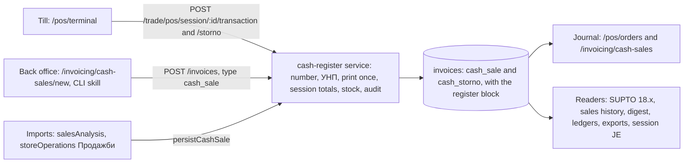

# FR-21 — One cash register: POS transactions and cash sales become one cash-register document

| | |
|---|---|
| **Status** | Specified 2026-10-21. The owner answered the three open questions the same day (D-5, D-12, D-13). Amended 2026-10-25: the invoice for a cash sale (D-14, §3.9, R0) was built first, ahead of R1 (#171, #203). |
| **Tracking** | [gjovanov/lgr#171](https://github.com/gjovanov/lgr/issues/171) |
| **Implementation** | Atanas Lazarovski (`lazarovski`) |
| **Code anchors** | origin/master `9cab263` (2026-10-21). They are anchors, not gospel. |

> **Request (owner, 2026-10-21):** "basically these two data sets correspond to the same concept: cash register operations: https://lgrai.app/pos/orders, https://lgrai.app/invoicing/cash-sales?status=draft,completed,paid — so we need to merge them. plan and design smooth implementation & migration. with integration, e2e tests."

## 0. Goal

- **One kind of document.** Every sale made at a cash register is the same kind of document in the same collection, whether it was rung on the POS terminal, entered in the back office or imported from PlusMinus. A storno is a document of its own that points at the sale it reverses.
- **One journal, „Касови продажби".** It is the same page at `/pos/orders` and at `/invoicing/cash-sales`. Both paths and both route names stay.
- **One write path.** The till, the back-office terminal and the importers all go through one service. It does the numbering, the УНП, print-once, session totals, stock and audit.
- **Every report sees every sale exactly once**, during the migration as well as after it.
- **History moves without changing a sale.** Each one keeps its `_id`, number, УНП and timestamps. Every release can be rolled back by redeploying the previous image.

## 1. Current state

### 1.1 Two worlds that both mean „касова продажба"

| | POS (`/pos/orders`) | Cash sales (`/invoicing/cash-sales`) |
|---|---|---|
| Stored in | `postransactions`, one row per receipt | `invoices`, `type: 'cash_sale'` |
| Written by | the POS terminal (`pos.controller.ts`) | the back-office terminal (FR-03), `POST /invoices`, PlusMinus imports (one document per business day) |
| Fiscal | УНП per device (#156), print-once (#155), storno receipts | none |
| Number | `TXN-YYYY-NNNNNNN`, hardcoded, not in the sequence registry | `CASH_SALE` → `CS-` (`CSR-` at regal) |
| Register session | `POSSession`, closed by FR-09 with a Z-report | none |
| Currency | none on the row, only on the session | on the document |
| Correction | storno: the original is flipped to `cancelled` and a `storno` row is added | none: a cash sale can't be voided or credited, and the UI can't edit it (FR-03 lists it as a "known limitation") |
| Revenue JE | one per session at close, with defects B-1 and B-2 | none, ever |
| Stock | its own `SM-` dispatch, found again by note text | `createInvoiceStockMovement`, linked by `invoiceId` |

### 1.2 Who reads what today

- **Both, as a union:**
  - SUPTO 18.1 lists POS rows and cash sales side by side.
  - Sales history (FR-08) joins the two.
- **Cash sales only:**
  - the daily digest
  - Reports → cash register
  - export kind `cash_register` and the FR-03 aggregate
  - the product ledger's "cash-register sales"
  - the contact ledger, last price and the dashboard

  So a till sale is missing from every one of them.
- **POS only:** SUPTO 18.2–18.5 and the session JE.

`docs/supto/COMPLIANCE-CHECKLIST.md` #3 already claims "POS + Cash Sales — единна система". This FR makes that true.

### 1.3 Defects found while mapping the two worlds

Each one is fixed in R1, with the first test it has ever had.

- **B-1. A stornoed sale is reversed twice.**
  - In the session JE, the original is skipped because it is `cancelled`, and the storno row is subtracted as well. The result is −X instead of 0 (`auto-journal.service.ts:358-361`).
  - Sales history does the same: it reads only `completed` POS rows and signs stornos −1.
- **B-2. The session JE has three more defects** (`auto-journal.service.ts:361, 380-383, 442-450`):
  - Revenue is `subtotal + discountTotal`, but the POS subtotal is already before the discount.
  - The cash debit is the amount tendered, not tendered minus change.
  - The over/short lines are one-sided.
  - `JournalEntry` has no balance check, so none of this is caught.
- **B-3. Sales history reads `t.currency` on POS rows** (`sales-history.report.ts:243`). The field doesn't exist, so every POS row is reported in EUR.
- **B-4. `POS-OUT` counts POS sales twice.** The batch movement written at session close is created `completed` without going through `confirmMovement` (`auto-journal.service.ts:388-418`). It duplicates every per-sale dispatch in SUPTO 18.8, FR-07 and FR-11.7c.
- **B-5. `lineTotal` means three different things:**
  - net on POS rows (`PosTerminalView.vue:623`)
  - gross on every document the UI creates (`document-payload.ts:194`)
  - net on imported cash sales (`map-cash-sale.ts:77`)

  The FR-03 aggregated export assumes gross (`invoice-export.controller.ts:256-257`), so an imported day exports its net as "gross".
- **B-6. `CashSalesView` filters and actions are broken:**
  - It offers `draft`/`completed`/`paid` (`:204-208`). No cash sale is ever `draft`, and `completed` is not in the enum.
  - With all three selected (`:322`) it sends no filter at all, so voided rows show up.
  - Its Void button appears on `paid` rows (`:57`), which `/void` always refuses (`invoice.controller.ts:1299`).
- **B-7. The SUPTO export likely drops the last day.** `dateTo` arrives as `YYYY-MM-DD` and becomes 00:00 UTC (`supto-export.controller.ts:68`). The POS tables are windowed on `createdAt`, so they probably lose that day. Confirm with a test before fixing.

Code anchors for everything above are in Appendix B.

## 2. Decisions

### D-1. The store is `Invoice`

Cash-register documents are `Invoice` rows of type `cash_sale` and of a new type, `cash_storno`. `POSTransaction` rows are copied into them, and the collection is then frozen.

**Why:**
- **The import contract.** `POST /invoices` with `type: 'cash_sale'` is a frozen import contract (README constraint #2), so cash sales cannot leave `Invoice`.
- **The readers.** Every reader in §1.2 already reads cash sales, so it starts seeing till sales without a new query.
- **The fiscal machinery.** POS brings print-once, the УНП, storno and the close. That machinery moves into a service, not into a model.
- **Ids carry over.** ObjectIds are unique across collections, so a copy keeps its `_id`. These links stay valid:
  - `/pos/orders/:id` links
  - `AuditLog.entityId`
  - `POSTransaction.movementId`
  - `originalTransactionId`
  - `POSSession` back-references

**Rejected:**
- **`POSTransaction` as the store.** It would fork `POST /invoices`, and every invoice reader would need a second query.
- **A third, new model.** Both worlds would move and every reader would be rewritten.
- **A read-only union.** It keeps two writers and all seven defects.

### D-2. A storno is its own document

- **Shape.** The type is `cash_storno`. Amounts are stored **positive** and the sign comes from the type, the same convention as credit notes. `relatedInvoiceId` points at the sale.
- **The original sale stays `paid`.** It is never flipped to `cancelled`. Instead it gets `register.stornoState: 'full'` and `register.stornoedBy`.
- **Readers** count `cash_sale − cash_storno`, using `paid` documents only.

This removes B-1 by construction. A reader that hasn't learned the new type under-counts refunds; it can never count them twice.

**Why not a `credit_note`:** credit notes share the invoice series (`SALES_DOC`), and a fiscal сторно бележка is not a кредитно известие.

**Side benefit:** back-office cash sales get the correction path FR-03 left out (a non-fiscal storno that returns the stock).

### D-3. The register block

`Invoice.register` exists only on the two cash-register types. It carries what `POSTransaction` has and `Invoice` lacks (§3.2).

### D-4. One service, three doors

`services/src/biz/cash-register/` contains `registerSale`, `registerStorno` and `toJournalRow`, plus the two mappings `fromPosTransaction` and `toPosTransaction`.

**The doors keep their routes, payloads and response shapes:**
- **The till:** `POST /trade/pos/session/:id/transaction` and `/storno`. The response stays `{ transaction, receiptError?, stockError? }`, built from the document, so a terminal left open during the deploy keeps working.
- **The back office and the CLI skill:** `POST /invoices` with `type: 'cash_sale'`. Its contract is frozen.
- **The importers:** `persistCashSale`.

**The steps** are #155's resumable steps, moved rather than rewritten: claim the key → insert under `~pending:<key>` → number → УНП → print once → session totals → stock → complete → audit.

**One failure rule replaces two:**
- **Before a receipt may have printed**, a failure rolls the document back. That is today's cash-sale behaviour.
- **Once `register.fiscal.state` is `pending`, `printed` or `unknown`**, nothing rolls back. The failure is recorded on the document (`stockError`, `receiptError`) and shown. That is today's POS behaviour.
- **Availability** is checked before the print.
  - The till door takes `allowNegative` from an org setting, default "allowed", so the till behaves as it does today.
  - The invoice door keeps its request flag.

### D-5. One number series — confirmed by the owner, 2026-10-21

- **New documents:** every new cash-register document, sale or storno, from any door, takes its number from `CASH_SALE` (`CS`, or `CSR` where configured).
- **`TXN`** becomes a closed legacy row in `sequence-registry.ts`. It allocates nothing, but FR-11.7b can still check its history.
- **Copied rows** keep their `TXN-…` numbers.
- **Other prefixes:**
  - `POS` (session numbers) moves into the registry (README constraint #4).
  - `POS-OUT` is retired.

### D-6. Revenue is posted exactly once

- **A document with a session** is posted by that session's close JE. The close JE now aggregates the session's cash-register documents:
  - sales minus stornos
  - cash as tendered minus change
  - VAT and discount consistent
  - balanced by construction
- **A document without a session** posts no revenue, as today (§11).
- **COGS** stays per movement.

### D-7. Stock goes through the invoice path

- **Every document** moves stock with `createInvoiceStockMovement`, so the movement carries `invoiceId`. A till sale then shows its number in FR-07, and FR-11.10 can see a till sale that moved nothing.
- **Till lines** take the session's warehouse.
- **A storno** books a `return` that restores the original movement's cost layers (the `reverseInvoiceStockMovement` machinery). Today it restocks at the sale price, which pulls `avgCost` towards the selling price.
- **The migration** only links existing movements. It never creates or confirms one.

### D-8. A fiscal document cannot be edited

- **Who refuses.** `PUT`, `DELETE`, `/void` and the Files delete-with-rollback answer **409 `register_document_immutable`**.
- **For which documents.** Those with `register.origin: 'pos'`, and every `cash_storno`.
- **How to correct one.** Storno it.

Today a POS row is immutable only because no route can change it. `PUT /invoices/:id` edits any document in any status (commit 1429c0a), so moving POS rows into `Invoice` must not open that door.

Back-office and imported cash sales keep today's rules. FR-20.51 owns those.

### D-9. One journal row

- **One DTO.** `toJournalRow` feeds both the list and the detail.
- **Endpoints.** `GET /org/:orgId/cash-register/documents` and `/:id`, gated on `pos.read || invoicing.read`.
- **While two stores exist**, the endpoint reads `Invoice` ∪ `POSTransaction` and drops any `POSTransaction` whose `_id` already has a copy.

### D-10. One page, two homes

`CashRegisterJournal.vue` and `CashRegisterDocument.vue` (ui-shared) are mounted at the paths below. The paths and route names are unchanged, so Playwright and per-route column prefs keep working (README constraint #3).

| Path | Route name |
|---|---|
| `/pos/orders` | `pos.orders` |
| `/pos/orders/:id` | `pos.orders.detail` |
| `/invoicing/cash-sales` | `invoicing.cash-sales` |
| `/invoicing/cash-sales/:id/edit` | `invoicing.cash-sales.edit` |

- **Unchanged until R5:** `/pos/terminal` and `/invoicing/cash-sales/new`.
- **Label.** Both apps call the journal „Касови продажби". That is the operator's own name for it ("в дневника на касовите продажби", #145). The POS menu item "Транзакции" is renamed.

### D-11. Migrations are versioned code

The copy and the freeze are `packages/migrations` entries (FR-20.19):
- idempotent
- scoped by `ctx.orgFilter`; since `9cab263` the CLI passes `homeScope()` (FR-20.5)
- `assertHomeIsHere` before every raw write (FR-20.4)
- never hand-run scripts (FR-20 README: "a data migration is code every node runs")

A read-only preflight script exists for rehearsals.

The ids used below (`0003`–`0006`) are indicative: `0002-file-sha256` exists, and each FR-21 migration takes the next free id when it lands.

### D-12. The `regal` org's test sales are removed before R2 — owner, 2026-10-21

The `regal` org holds the POS test sales made on a Tremol test device in March–April 2026. Once R2 copies them, they become immutable cash-register documents with no way back. So they are removed first, by a one-off, dry-run-first cleanup (FR-21.14, §5.2).

### D-13. A back-office sale joins the cashier's open session — owner, 2026-10-21, in R5

If the person entering a back-office cash sale has an open session, the sale joins it:
- it counts in the session totals and the close JE;
- it prints on the session's device, as a till sale does.

The cash is in that drawer, so the close expects it. With no open session, the sale stays sessionless.

This needs the single terminal of R5 (FR-21.29–FR-21.31).

### D-14. An invoice for a cash sale is a tax document, not a second sale — owner, 2026-10-25, shipped as R0

A customer who bought at the counter asks for a фактура. The cash-register document already moved the goods and took the money, so the invoice is the tax document of that same sale (§3.9):
- it moves no stock (it carries `stockSource`), is born paid, and posts no journal entry;
- the cash-register document keeps the sale: every reader counts it once (§3.3);
- only the invoice stores the link (`cashSaleRef`). The sale is never written to, so the immutability of D-8 needs no exception.

The owner's answers (2026-10-25):
- **A sale that names a customer is invoiced whole, once.** A sale without one (an imported till day, a walk-in) may be invoiced in parts, never beyond what was sold.
- **The dialog issues at once**; a draft is the secondary choice.
- **Credit and debit notes on such an invoice are ordinary documents**: a credit note returns the goods and counts negative, as on any invoice. Before R2 there is no other correction for a back-office cash sale.

Built first because the operators asked for it (#203) and it needs only today's `cash_sale`. Till sales become eligible on their own when R2 copies them into `Invoice`.

## 3. Design

### 3.1 Overview

### 3.2 The register block (`Invoice.register`)

| Field | From `POSTransaction` | Notes |
|---|---|---|
| `origin` | — | `pos` = the till, `backoffice` = the form or the API, `import` = a PlusMinus day, via Files or the CLI. On existing cash sales it is backfilled: `import` when the document is tagged `cash-register-import`, its reference is `salesAnalysis:<date>`, or a DocFile committed it; `backoffice` otherwise. |
| `sessionId`, `warehouseId`, `cashierId` | `sessionId`, and the session's warehouse and cashier | |
| `fiscalDeviceNumber`, `operatorCode` | `fiscalDeviceNumber`; `operatorCode` parsed from the УНП (`DDDDDDDD-OOOO-NNNNNNN`) | New documents take `operatorCode` from the signed-in user. |
| `unp`, `fiscalReceiptNumber`, `printedAt`, `isFiscal` | `unpNumber`, `fiscalReceiptNumber`, `printedAt`, `isFiscal` | Index `{orgId, 'register.unp'}`. It is unique-partial when the preflight finds no duplicate. Today the УНП is not unique in the database (`pos-transaction.model.ts:197`). |
| `fiscal { state, mode, attemptedAt, counterBefore, receiptNo, printedAt, error }` | `fiscal` (#155) | The print-once state machine, unchanged |
| `changeDue` | `changeDue` | |
| `sessionTotalsApplied`, `receiptError`, `stockError` | same | |
| `storno { originalId, originalUnp, originalReceiptNumber, originalDate, reason }` | `originalTransactionId`, `originalUNP`, `originalFiscalReceiptNumber`, `originalTransactionDate`, `stornoReason` | On `cash_storno` only |
| `stornoState`, `stornoedBy[]`, `cancelledAt` | derived | On the sale. `cancelledAt` keeps the `updatedAt` that SUPTO 18.5 prints as "Cancelled". |
| `legacy { source: 'postransactions', type, transactionNumber }` | | On copies only |

**Two smaller schema additions:**
- **`payments[].tendered`** (optional): what the customer handed over when it differs from what was kept. `amount` is always the amount kept, so `Σ payments.amount = total` holds for every reader. SUPTO 18.2 prints `tendered ?? amount`, exactly as today.
- **`payments[].method`** gains `mobile` and `voucher`. They are legacy values only: accepted from the migration and from the till API (as #145 left them), offered by no UI, and bucketed as "other" by every report.

**New indexes:**
- `{orgId, type, issueDate: -1}`. The journal needs it, and `Invoice` has no `type` index today.
- `{orgId, 'register.sessionId'}`
- `{orgId, 'register.unp'}`

### 3.3 Who reads what, release by release

| Reader | Today | R1 | R2–R3 | R4 |
|---|---|---|---|---|
| Journal: the new endpoint, both pages | — | union, de-duplicated by `_id` | union | `Invoice` only |
| SUPTO 18.1–18.5 | POS; 18.1 also cash sales | union | union | `Invoice` |
| Sales history (FR-08) | union, double-counts stornos | union, fixed | union | `Invoice` |
| Session close JE | POS | union, fixed | union | `Invoice` |
| `GET /trade/pos/transactions[/:id]` | POS | union, legacy shape | union | removed |
| Keyed replay (`Idempotency-Key` lookups) | own store | both stores | both stores | `Invoice` |
| Digest, Reports cash register, export `cash_register` and aggregate, product and contact ledger, last price, dashboard | cash sales | + `cash_storno`, `paid` only | till sales appear | `Invoice` |

**The counting rule, in both stores (FR-21.1):** a sale counts whether or not it was stornoed; a storno counts negative; nothing voided counts.
**And, since R0 (D-14):** an invoice issued for a cash-register document (`cashSaleRef`) never counts as a sale in a total — its cash-register document does. Per customer, the invoice counts for its customer, and its cash-register document no longer counts for that document's own contact. One helper holds both rules (`services/biz/sale-counting.ts`); every reader of this table applies it on top of FR-21.1.
- **In `POSTransaction`:**
  - A `sale` row counts in either status. A sale is `cancelled` only by its storno.
  - A `storno` row counts negative only when `completed`.
- **In `Invoice`:** `cash_sale` and `cash_storno` documents count when `paid`.

### 3.4 The journal

**Columns:**
- **On by default:** Number · Date & time · Kind (Sale / Storno) · Origin (Till / Back office / Import) · Customer · Payment (every method, not only `payments[0]`) · Total (in the document's currency, not the org's base currency) · Fiscal (УНП and receipt number, or the fiscal state) · Status.
- **Off by default:** Session · Cashier · Warehouse · Device · Subtotal · VAT · Stock (moved / error / none) · Reference.
- **Invoice (D-14):** the invoices issued for the document, with an "invoiced: yes / no" filter. It replaces the column the R0 list has today and reads it the same way (`invoicingByCashSale`, `services/biz/cash-sale-invoice.service.ts`).

**Filters.** All of them live in the URL (FR-05). Each declares its default, so a filter nobody touched writes nothing.
- the filters: search (number, УНП, reference) · kind · origin · status (Completed / Stornoed / Voided) · fiscal state · session · warehouse · cashier · payment method · date range (in the org's time zone)
- An old link carrying `status=draft,completed,paid` reads as "all".

**Actions:**
- **View.**
- **Storno.** On eligible rows (§3.5), for roles admin/manager/warehouse_manager as in #145, using the existing `StornoDialog`.
- **Print.** The „КАСОВА ПРОДАЖБА" PDF, or the storno PDF.
- **Email**, as today.
- **Export:** the list, and the FR-03 aggregate.
- The Void button goes.

**Detail page:**
- **Header:** number, kind, origin, status, session, cashier, device, УНП, receipt number and fiscal state.
- **Lines:** every line, including unmatched free-text lines. Today's detail hides those, yet still counts them in the total (`CashSaleTerminal.vue` filters the cart on `productId`).
- **Payments:** shown with the tendered amount and the change.
- **Links:** the storno chain in both directions, the stock movement, and the session's JE.

**Saved preferences.** Saved column prefs that name a removed column drop that key, and new columns start in their default state.

### 3.5 Storno

- **Which sales:** a `paid` `cash_sale` whose `stornoState` is not `full`, with origin `pos` or `backoffice`.
- **Imported PlusMinus days are refused.** They are corrected by re-import.
- **Fiscal original:** needs an open session in its own warehouse and prints a storno receipt, as today (same till, same fiscal device).
- **Non-fiscal original:** prints nothing and needs no session.
- **Stock:** the `return` restores the original movement's cost layers (D-7). If the original moved no stock (`stockError`), the storno moves none either.
- **Unchanged:** a storno of a storno, and a second storno of the same sale, are refused as today. The claim on the original is atomic.
- **An invoiced sale (D-14):** a quantity is corrected once — by a storno, or by a credit note to its invoice, never both. Storno eligibility excludes what credit notes to the sale's invoices already returned, and a credit note can no longer return what a storno restored. Until R2 implements that, a storno of an invoiced sale is refused.

### 3.6 Fiscal and SUPTO

- **What stays the same.** The print-once state machine (#155), the per-device УНП counter (#156) and FR-09's Z-report-first close all carry over unchanged. FR-21 changes where a row lives, not what the till does.
- **The SUPTO tables** read the register block:
  - 18.1 keeps listing every cash sale.
  - 18.2–18.5 keep listing what was a POS row (`origin: 'pos'`).
  - 18.3 keeps printing the net line value (`lineTotal − taxAmount`).
  - 18.5 keeps listing stornoed sales and voided stornos, with `register.cancelledAt`.
- **This is a new SUPTO version, because the database structure changes:**
  - `docs/supto/DATABASE-SCHEMA.md` and `FUNCTIONAL-DESCRIPTION.md` change in the R2 PR, as #163 did.
  - FR-20.50's declaration rule applies once LGR is declared.
- **`SUPTO_MODE`** still enforces nothing (FR-09). After FR-21, the till door is the one place where it will.

### 3.7 Accounting

D-6, in detail:

| Document | Revenue and VAT | Money | COGS |
|---|---|---|---|
| With a session | the session close JE: revenue = Σ ±(total − taxTotal), tax = Σ ±taxTotal | per method, the amount kept | per movement, unchanged |
| Without a session | none, as today | none, as today | per movement, unchanged |

**Over/short:** the cash difference posts against a configured over/short account. With none configured it isn't posted; it stays on the session record. It is never one-sided.

**Out of scope:** where VAT is credited (today: to the revenue account, in both `invoice.posted` and the session JE) is a separate accounting fix (§11).

### 3.8 Stock

| | Today: cash sale | Today: POS | After FR-21 |
|---|---|---|---|
| Path | `createInvoiceStockMovement` | own `SM-` movement | `createInvoiceStockMovement` |
| Link | `invoiceId` | note text | `invoiceId` |
| Warehouse | per line | session | per line; till lines take the session's |
| Failure | rolls back | recorded, sale stands | one rule: rolls back before a receipt may have printed, recorded after (D-4) |
| Availability | checked unless `allowNegativeStock` | not checked | checked before the print; the till's `allowNegative` comes from an org setting, default allowed |
| Storno / void | void reverses cost layers | restocks at the sale price | restores cost layers |

### 3.9 Invoice for a cash sale („Фактура към касова продажба") — R0, shipped 2026-10-25

`GET` and `POST /org/:orgId/invoices/:id/to-invoice` (`services/biz/cash-sale-invoice.service.ts`):

| | Rule |
|---|---|
| Which documents | A `paid` `cash_sale`. After R2 also a till sale, and the PDF adds its УНП and receipt number. |
| Customer | Required: a customer, or a contact of both kinds, created inline when new. |
| Lines | The sale's lines, at its price, discount and VAT. A sale that names a customer: every line, once. A sale without one: any subset, any quantity up to what is not yet invoiced. |
| Totals | A whole sale: the cash-register document's own totals, to the cent. A part: recomputed as the invoice form computes them. |
| Stock | None. `stockSource` = `cash_sale:<number>`, which issue, void and the Files rollback honour. |
| Money | Born `paid`: one payment row per tender of the sale (`origin: 'cash_register'`), and no `payment.recorded`. |
| Journal | None. `/send` emits no `invoice.posted` for it, and the handler skips it. |
| Number | SALES_DOC when issued, DRAFT_INV as a draft. The claim is taken under a `~pending:` placeholder first, so a refused request burns no number. |
| Dates | `taxEventDate` = the date of the sale, printed as „Дата на данъчното събитие". Issued more than 5 days later: the dialog warns (ЗДДС чл. 113, ал. 4). Dated before the sale: refused. |
| Edits | Issued: the customer and the text only; the lines and the dates are the sale's. A draft may invoice less. Neither may add a line. |
| Void | Allowed when `paid`. Nothing to reverse; the quantities go back to the sale. |
| Concurrency | Each line's quantity is a budget across the live invoices, drafts included. Claims are taken in `_id` order and a later one that does not fit gives way, so nothing locks or writes the sale. |
| Guards | A cash sale's lines cannot change while an invoice points at them (409 `cash_sale_invoiced`). The Files rollback of such a sale is blocked. A plain create or edit cannot set the link. |

## 4. Requirements

Language as in `docs/fr/README.md`: **MUST**, **SHOULD**, **MAY**.

### R0 — invoice for a cash sale (D-14, §3.9) — shipped 2026-10-25

| # | Req | |
|---|---|---|
| FR-21.33 | MUST | `POST /invoices/:id/to-invoice` issues an invoice for a paid cash sale: no stock, born paid, no journal entry, linked by `cashSaleRef` and `lines[].cashSaleLineId`. |
| FR-21.34 | MUST | Quantities: whole and once for a sale that names a customer, in parts otherwise, never beyond what was sold — under concurrency and retries (`Idempotency-Key`). |
| FR-21.35 | MUST | The counting rule of §3.3 in every reader: sales history, the digest (KPIs, FR-11.10, FR-11.11), the product and contact ledgers, the dashboard. The sales register keeps the invoice and names its cash sale. |
| FR-21.36 | MUST | The edit, void, issue, rollback and plain-create guards of §3.9. |
| FR-21.37 | MUST | The invoice prints the cash sale and its date, and `taxEventDate` as its tax event. |
| FR-21.38 | MUST | UI: „Издай фактура" on the cash sale and on its row, the dialog, the invoices of a sale in both places, and the banner on the invoice. |

### R1 — the read side (no new writer, no data moved except `0003`/`0004`)

| # | Req | |
|---|---|---|
| FR-21.1 | MUST | The counting rule of §3.3, in every reader. It fixes B-1 in the session JE and in sales history. |
| FR-21.2 | MUST | The session JE balances (§3.7), and it gets its first tests (B-2). |
| FR-21.3 | MUST | Sales history takes a POS row's currency from its session (B-3). A cash sale's drill-down opens the journal detail, not `/invoicing/invoices/:id/edit`. |
| FR-21.4 | MUST | No `POS-OUT` movement is created any more. Migration `0004-pos-out-record-only` flags the existing ones `recordOnly: true`, and SUPTO 18.8, FR-07 and FR-11.7c skip that flag (B-4). |
| FR-21.5 | MUST | `lineTotal` is gross on every cash-register document (B-5). - `map-cash-sale.ts` and `scripts/import-cash-register-sales.ts` write gross. - Migration `0003-cash-sale-line-totals` converts historic imported lines. It is idempotent: a line converts only while `lineTotal ≈ quantity × unitPrice`. - Side effect: the product ledger's cash-register total for imported days rises by the VAT it was missing. Say so in the release note. |
| FR-21.6 | MUST | The SUPTO `dateTo` covers the whole last day in the org's time zone, once a test confirms B-7. |
| FR-21.7 | MUST | The schema of §3.2: `Invoice.register`, type `cash_storno`, `payments[].tendered`, the legacy payment methods and the three indexes. No writer uses them yet. |
| FR-21.8 | MUST | Union readers (§3.3) read `Invoice` cash-register documents ∪ `POSTransaction`, and drop a `POSTransaction` whose `_id` has a copy. The union readers are: the journal, SUPTO 18.1–18.5, sales history, the session JE and `GET /trade/pos/transactions[/:id]`. |
| FR-21.9 | MUST | Invoice-only readers learn `cash_storno` and count `paid` documents only: - the digest, which also stops counting voided cash sales - Reports → cash register - export `cash_register`, including the aggregate - the product and contact ledgers - the dashboard  Last price ignores stornos. |
| FR-21.10 | MUST | Keyed lookups (`Idempotency-Key`) on the till routes and on `POST /invoices` check both stores. |
| FR-21.11 | MUST | D-8: `PUT`, `DELETE`, `/void` and the Files delete-with-rollback answer 409 `register_document_immutable` for `register.origin: 'pos'` and for every `cash_storno`. |
| FR-21.12 | MUST | `GET /org/:orgId/cash-register/documents` and `/:id`, through the `toJournalRow` DTO, gated on `pos.read \|\| invoicing.read`. Filters, sorting and paging as in §3.4. |
| FR-21.13 | MUST | The journal of §3.4 at the four routes of D-10. It fixes B-6. |

### Before R2

| # | Req | |
|---|---|---|
| FR-21.14 | MUST | Remove the `regal` org's March–April 2026 test sales (D-12), by the procedure of §5.2. It runs, and is verified, before R2 is deployed. |

### R2 — the write side

| # | Req | |
|---|---|---|
| FR-21.15 | MUST | The service of D-4, with its three doors. Routes, payloads and responses are unchanged; the till's response is built from the document. |
| FR-21.16 | MUST | One failure rule, and availability checked before the print (D-4). The till's `allowNegative` comes from an org setting, default allowed. |
| FR-21.17 | MUST | Numbering (D-5): - `CASH_SALE` for every new document, sale or storno - `TXN` becomes a closed legacy registry row - `POS` session numbering moves into the registry - `POS-OUT` is retired |
| FR-21.18 | MUST | Storno as in D-2 and §3.5. |
| FR-21.19 | MUST | The session close JE runs over cash-register documents, posting each exactly once (D-6). |
| FR-21.20 | MUST | Stock goes through `createInvoiceStockMovement` with `invoiceId`; till lines take the session's warehouse (D-7). |
| FR-21.21 | MUST | Migration `0005-cash-register-copy` (§5.3). |
| FR-21.22 | MUST | A restore converts older bundles (§5.5). |
| FR-21.23 | MUST | `docs/supto/DATABASE-SCHEMA.md` and `FUNCTIONAL-DESCRIPTION.md` describe the cash-register document. This is a new SUPTO version (FR-20.50). |
| FR-21.24 | MUST | `POST /invoices` declares `pendingTransferIds` in its body schema. Today it is read (`invoice.controller.ts:518, 667`) but not declared, so Elysia's `normalize` likely strips it. First prove with an HTTP-level test what happens today. |

### R3 — freeze

| # | Req | |
|---|---|---|
| FR-21.25 | MUST | Migration `0006-cash-register-freeze` copies stragglers and re-runs the parity check over the whole history. It throws on a mismatch. |
| FR-21.26 | MUST | The `POSTransaction` model refuses writes: its hooks throw `postransactions is frozen (FR-21)`. Raw writes are listed in `home-write-guard.flow.test.ts`. |

### R4 — contract

| # | Req | |
|---|---|---|
| FR-21.27 | MUST | No reader queries `postransactions`. These are removed: - `GET /trade/pos/transactions*` - the deprecated `erp.service` POS functions and their unit test - the POS entities in `dal` |
| FR-21.28 | MUST | At startup the server checks that `0006` is recorded. If it isn't, the cash-register routes answer 503 with the reason (the `0001-unp-per-device` pattern). |

### R5 — one terminal

| # | Req | |
|---|---|---|
| FR-21.29 | MUST | One `RegisterTerminal` component (ui-shared) serves both `/pos/terminal` and `/invoicing/cash-sales/new`. |
| FR-21.30 | MUST | One totals function, `computePosTotals`, for every cash-register document. |
| FR-21.31 | MUST | D-13: a back-office sale by a user with an open session joins that session. It counts in the session totals and the close JE, and prints on the session's device the way a till sale does. With no open session, it stays sessionless. |
| FR-21.32 | SHOULD | The till's write routes require `pos.write`. Turn this on only once the preflight's list of users who used the till in the last 90 days without that permission is empty. |

## 5. Migration

### 5.1 Releases

Each release is deployed before the next one merges. R1 may ship as several PRs, but all of them must be deployed before R2.

| | Ships | Migration | Rolling back to the previous image |
|---|---|---|---|
| **R1: read side** | FR-21.1 – FR-21.13 | `0003-cash-sale-line-totals`, `0004-pos-out-record-only` | Safe. Data changed only in a way the old code reads correctly. |
| **Before R2** | FR-21.14 | the one-off cleanup of §5.2 | Not applicable: there is a backup, and the cleanup is a deliberate removal. |
| **R2: write side** | FR-21.15 – FR-21.24 | `0005-cash-register-copy` | Safe. R1 reads both stores, knows `cash_storno`, guards register documents and replays keys from either store.  **Limitation:** a sale made under R2 can't be stornoed under R1 until R2 is back. |
| **R3: freeze** | FR-21.25 – FR-21.26 | `0006-cash-register-freeze` | Safe. R2 never writes `POSTransaction`. |
| **R4: contract** | FR-21.27 – FR-21.28 | — | Safe. R3 still dual-reads. |
| **R5: one terminal** | FR-21.29 – FR-21.32 | — | UI, plus the session join of D-13. |

### 5.2 Before R2: removing the `regal` org's test sales (FR-21.14)

**Why.** These are test sales the owner decided to remove on 2026-10-21. After R2 they would be immutable cash-register documents. FR-13.44 forbids *automatic* pruning of `POSTransaction`. This is a one-time removal of test records by an explicit owner decision, with a backup, and this section is its record.

**What exists:** about 73 sales from March–April 2026 on a Tremol test device. As of 2026-09-26, 40 of them had no stock movement. The dry run gives the real numbers.

**The script.** A one-off at `scripts/remove-test-pos-sales.ts --org regal --from 2026-03-01 --to 2026-04-30`. It is not part of any server package.
- **Dry run by default.** It lists every row it would touch: sales, stornos, sessions, movements, journal entries, POS-OUT. It also lists each sale's fiscal flag and device, and refuses to go on if anything in `regal` lies outside the window.
- **Refuses** any org other than `regal`, and any node that is not the org's home (FR-20, P0b-6).
- **`--execute`:**
  1. Write every touched document as NDJSON to a backup file on mars before changing anything.
  2. Refuse if the counts differ from the dry run.
  3. For each sale, newest first:
     - reverse its stock movement exactly (StockLevel and cost layers);
     - decrement its session's totals;
     - delete the row.
  4. Delete sessions left without rows.
  5. Delete or void the journal entries whose source is a removed session or movement (if there are any), and any `POS-OUT`.
  6. Keep the AuditLog append-only: add one `cleanup` entry per removed row, and never delete history.
- **Verify afterwards:**
  - `regal` has no `POSTransaction` in the window.
  - For every affected product, StockLevel = before + Σ removed dispatch quantities.
  - The §5.3 preflight for `regal` is clean.
- **Precedent:** the prod test-sale cleanups of 2026-09-26 and 2026-09-28. They were dry-run first and backed up on mars.

### 5.3 `0005-cash-register-copy`, per org

1. **Preflight.** It throws before writing anything. `scripts/cash-register-preflight.ts` prints the same report and writes nothing.
   - **Blockers:**
     - `return`/`exchange` rows (the terminal never sends them)
     - an `_id` or number already present in `invoices`
     - a `clientKey` present in both stores
     - a storno whose original is missing
     - a row whose session is missing
     - a session currency other than the org's base currency, unless the pair is BGN/EUR
   - **Warnings:**
     - a duplicate УНП (the unique index is then skipped for that org)
     - `mobile`/`voucher` payments
     - rows with `stockError`
     - `POS-OUT` movements
     - days that have both till sales and an imported till day for the same org. That is a parallel run, and it counts the same goods twice.
2. **Copy.** Walk `postransactions` with a cursor in batches of 500, and insert each row by `_id` only if absent. Each session is read once, for its currency, warehouse and cashier.
3. **Link.** For each row's `movementId`, set `StockMovement.invoiceId = _id`, but only where it is unset.
4. **Backfill** `register.origin` on existing cash sales (§3.2).
5. **Parity.** It throws on any mismatch. A failed migration is not recorded, so it runs again.
   - **Per row:**
     - `_id`, number, type and status mapping
     - `createdAt` and `updatedAt`
     - УНП, receipt number and device number
     - `subtotal`, `discountTotal`, `taxTotal` and `total`, exact
     - payments by method
     - lines: count, product, quantity, unit price, tax, and net value to the cent
     - storno links, and the movement link
   - **Per session and per day:**
     - count
     - Σ total
     - Σ per method
     - Σ per VAT rate
   - **SUPTO 18.1–18.5 over the org's whole history:** the rows built by the R1 union reader must equal the rows built from `Invoice` alone. Money is compared in cents.

### 5.4 Field mapping, `POSTransaction` → `Invoice`

| `POSTransaction` | `Invoice` |
|---|---|
| `_id`, `orgId` | same |
| `transactionNumber` | `invoiceNumber`, plus `numberHistory` and `register.legacy.transactionNumber` |
| `type` sale / storno | `type` `cash_sale` / `cash_storno`, with `direction: 'outgoing'` |
| `status` completed | `paid` |
| `status` cancelled, on a sale | `paid` + `register.stornoState: 'full'` + `register.cancelledAt = updatedAt` |
| `status` cancelled, on a storno (its print failed) | `voided` |
| `createdAt`, `updatedAt`, `completedAt` | same, written with timestamps off. `issueDate`, `dueDate` and (when paid) `paidAt` are set to `createdAt`. |
| `customerId` | `contactId` |
| the session's `currency` | `currency`. `exchangeRate` is 1, or 1/1.95583 for a BGN session in an EUR org (the rate is the base-currency value of one unit: `totalBase = total × exchangeRate`). `totalBase` follows. |
| the session's `warehouseId` | every line's `warehouseId`, and `register.warehouseId` |
| `lines[].name` | `lines[].description`. `unit` comes from the product, falling back to `бр.` |
| `lines[].productId`, `quantity`, `unitPrice`, `discount`, `taxRate`, `taxAmount`, `priceExplanation` | same |
| `lines[].lineTotal` (net) | `lineTotal` = round2(net + `taxAmount`), the `Invoice` convention (gross) |
| `subtotal`, `discountTotal`, `taxTotal`, `total` | same, exactly: these are the receipt's figures |
| `payments[] { method, amount, reference }` | `payments[] { date: createdAt, method, amount: kept, tendered?, reference }`. `amountPaid = total`, `amountDue = 0`. `paymentMethod` is the method when there is only one. |
| `changeDue` | `register.changeDue` |
| `movementId` | `StockMovement.invoiceId = _id` on that movement |
| `originalTransactionId`, `originalUNP`, `originalFiscalReceiptNumber`, `originalTransactionDate`, `stornoReason` | `relatedInvoiceId`, plus `register.storno.*` |
| `unpNumber`, `fiscalReceiptNumber`, `fiscalDeviceNumber`, `printedAt`, `isFiscal`, `fiscal`, `receiptError`, `stockError`, `sessionTotalsApplied` | `register.*` |
| `clientKey`, `requestHash` | same, so a replay keeps working across the deploy |
| `createdBy` | `createdBy`. `register.cashierId` comes from the session. |
| `invoiceId` | dropped (it was never written) |
| — | `billingAddress` placeholders as `POST /invoices` writes them. One `statusHistory` entry, reason `migrated_from_pos`. |

`POSSession` rows, closed-session JEs and audit entries are not touched. Their `_id` references stay valid.

### 5.5 Restoring an older bundle

After R2, an FR-13 restore of a bundle taken before R2 brings back `POSTransaction` rows that have no copies. So the restore runs the same per-org copy (it is idempotent) before it unlocks the org.

## 6. Edge cases

1. **Keyed retry across the deploy.** The keyed lookup checks `invoices`, then `postransactions`. A hit in the old store is copied on the spot, then replayed. The same holds in the other direction after a rollback to R1.
2. **A session open across the deploy.** Its sales from before the deploy (copied) and after it (new) close in one JE, each counted once.
3. **Storno of a copied sale.** The claim is taken on the copy. The frozen `POSTransaction` is never touched.
4. **Rolling deploy with automatic migrations.** Rows the old pod writes after the copy are read through the union in R2 and copied by `0006`.
5. **Rollback from R2 to R1.** Sales made under R2 stay visible and protected, but can't be stornoed until R2 is back. This is documented, not fixed.
6. **A parallel run** (an imported till day plus till sales for the same day) counts the same goods twice. The preflight lists such days, and the journal shows each row's origin.
7. **`return`/`exchange` rows.** The terminal never sends them, so any count above zero is a blocker for a human to decide.
8. **A BGN session in an EUR org.** The document currency is BGN, with `exchangeRate` 1/1.95583 (one lev in euros, at the fixed changeover rate). Any other currency pair is a blocker.
9. **A Tremol print in state `unknown`** is copied as it is and never reprinted.
10. **`POS-OUT`.** From R1 none is created, and `0004` flags any that exist as record-only, so 18.8, FR-07 and FR-11.7c stop counting them twice.
11. **A duplicate УНП in history** is reported, and the unique index is not created for that org.
12. **FR-20.**
    - The copy calls `assertHomeIsHere` per org. On a future master it runs as the same migration.
    - There is no new model, so no new replication class.
    - Idempotency keys stay on documents (FR-20.37).
    - The offline till (FR-20.104) would land its sales as `origin: 'pos'` documents with `fiscal.state: 'printed'`.
13. **A large org.** The copy runs in batches of 500 under the 10-minute lock, renewed as it goes. A re-run continues where the last one stopped.
14. **R5, a back-office sale while its author has an open session in a different warehouse.** It still joins the session, because the cash is in that cashier's drawer. Its lines keep their own warehouses for stock.

## 7. Integration and regression constraints

- **`docs/fr/README.md`:**
  1. The bills import is untouched.
  2. The `POST /invoices` contract is frozen, including `skipStockMovement` and `allowNegativeStock`, and the `reference`/`tags` the import skill sends.
  3. Route names are kept: `pos.orders`, `pos.orders.detail`, `invoicing.cash-sales`, `.new` and `.edit`.
  4. Prefixes come from the registry; FR-21 also fixes POS's hardcoded `TXN`, `POS` and `POS-OUT`.
  5. `bun run test`, `bun run build` and `bun run test:e2e` pass, with no `.rejects`/`.resolves` anywhere.
- **FR-20 (`feat/fr-20-offline` README):**
  - Writes check the home.
  - Data migrations are code in `packages/migrations`.
  - No new model without a replication class.
  - Idempotency keys live on documents.
- **SUPTO:** the database structure change is a new SUPTO version (FR-20.50). No issued sale is changed (FR-20.51), and copies keep their content and original times.

## 8. Test plan

### 8.1 Integration (`packages/tests/src/integration`)

| File | Release | Covers |
|---|---|---|
| `cash-sale-invoice.flow.test.ts`, `cash-sale-invoice-readers.flow.test.ts` | R0 | The invoice for a cash sale over HTTP: whole and partial, the budget under concurrency and retries, drafts, void, credit notes, edits, refusals and the rollback block; and every reader counting the sale once. |
| `cash-register-readers.flow.test.ts` | R1 | One till sale is seeded three ways: only in `postransactions`, only in `invoices`, and in both under the same `_id`. Every reader in §3.3 counts it once. A sale and its storno net to 0 in the session JE and in sales history. |
| `pos-session-journal.flow.test.ts` | R1 | The first tests the handler has had. The entry stays balanced with: a discount, change, a storno in the same session, a storno in a later session, and over/short. |
| `cash-register-journal.flow.test.ts` | R1 | Filters, paging, sorting and the org's time zone. The permission gate and tenant isolation. Rows built from two sources equal rows built from one. Legacy `status=` values. |
| `cash-sale-line-totals.migration.test.ts` | R1 | `0003` converts imported lines once and is idempotent. It leaves UI-created lines alone. The FR-03 aggregate then agrees with the document totals. |
| `cash-register-immutability.flow.test.ts` | R1 | `PUT`, `DELETE`, `/void` and the Files delete-with-rollback all answer 409 for till documents and storno documents. Back-office documents behave as before. |
| `test-pos-sales-cleanup.flow.test.ts` | before R2 | The §5.2 script. The dry run writes nothing. `--execute` restores stock exactly, keeps the audit history and adds `cleanup` entries. It refuses another org, rows outside the window, and a count that changed since the dry run. |
| `cash-register-sale.flow.test.ts` | R2 | Each door on the Eltrade simulator: the document, the register block, a `CS` number, the УНП, exactly one receipt, the session totals, and stock linked by `invoiceId`. A failure before the print rolls back; a failure after it does not. `pendingTransferIds` reaches the transfers, tested at the HTTP level. |
| `cash-register-storno.flow.test.ts` | R2 | The nine cases of `pos-storno.flow` on the new store, plus: the original stays `paid` with `stornoState`; a non-fiscal storno; an imported day is refused; the return restores cost layers. |
| `cash-register-idempotency.flow.test.ts` | R2 | The cases of `pos-idempotency.flow` and `invoice-idempotency.flow` on the new store, plus the deploy case. R1 code writes a keyed sale as a `POSTransaction`; the same key retried against R2 code replays it, with no second document, УНП or receipt. Also the reverse, R2 → R1. |
| `cash-register-migration.flow.test.ts` | R2, R3 | A fixture with every shape (below). Preflight blockers. The copy, the links and the parity check. A re-run is a no-op. `0006` copies stragglers. The frozen model refuses writes. A pre-R2 bundle is restored and converted. |
| `cash-register-session-join.flow.test.ts` | R5 | A back-office sale by a user with an open session joins it: totals, close JE, and the receipt on the session's device. Without an open session it stays sessionless. |
| updated | all | `pos-transaction`, `pos-idempotency`, `pos-storno`, `pos-eltrade`, `pos-stock-movement`, `pos-totals`, `unp-per-device`, `sales-history.report`, `daily-digest`, `reports-p2`, `cash-agg-export`, `product-ledger`; `migrations` (re-run AC 8 with POS and cash-sale fixtures); `home-write-guard` (list the new raw writes); `tenant-isolation` (the new routes) |

**Fixture shapes for the migration test:**
- **Sales:** fiscal and printed · text mode · print failed · print `unknown` (Tremol)
- **Stornos:** a storno (its original is `cancelled`) · a storno whose print failed (voided)
- **Payments:** split tender with change · `mobile`/`voucher`
- **Other row shapes:** customer set · a BGN session in an EUR org · a sale with `stockError` · a keyed sale
- **Session and timing:** a session left open during the copy · a sale and its storno in two different sessions
- **Extras:** a `POS-OUT` movement · a `return` row (the blocker)

### 8.2 Unit

- `toPosTransaction(fromPosTransaction(x))` is the identity on every fixture shape.
- `toJournalRow` gives the same row for a `POSTransaction` and for its copy.
- Storno eligibility (§3.5).
- Payment-method buckets.

### 8.3 E2E (`packages/e2e`)

**A fiscal device for Playwright.** `scripts/eltrade-tcp-stub.ts` wraps `EltradeSimulator.exchange` (`tests/src/helpers/eltrade-simulator.ts:77`) in a TCP server that speaks ISL frames. Eltrade already connects over TCP through `IslTcpTransport` (`fiscal/src/fiscal-device.service.ts:32-35`). The e2e seed adds a `tcp` device at `127.0.0.1:<port>`. Like `ocr-stub.ts`, it needs no hardware and no secret.

**`cash-register.spec.ts`:**
1. **Fiscal sale.** Open a session and sell two items by card with the fiscal device. The receipt shows the УНП. The sale appears in `/pos/orders` and in `/invoicing/cash-sales` with the same number, total and УНП.
2. **Back-office sale.** A back-office cash sale appears in `/pos/orders`.
3. **Storno.** Storno it from the invoicing journal.
   - The storno row appears in both journals.
   - The sale shows „Сторнирана".
   - The product's stock is back where it was.
4. **Close.** Close the session.
   - The Z-report runs on the simulator.
   - The session closes.
   - Expected cash equals sales minus the storno.
5. **Persistence.** Filters and column choices survive a reload, and survive moving to the other app's page.
6. **Old links.** An old `/pos/orders/:id` link to a copied row opens it.
7. **Export.** The export, both list and aggregate, includes the till sale.
8. **Roles.**
   - A cashier (role `sales`) sees no Storno button.
   - An accountant without `pos.read` sees the journal in invoicing.
9. **R5:** with a session open, a back-office sale prints on the simulator and the close expects its cash.

**Other specs:**
- **`cash-register-migration.spec.ts`** (its own project and seed). It seeds legacy rows and runs the migrations. Both journals then show the same rows and totals as before.
- **`pos-transactions.spec.ts` and `cash-sales.spec.ts`** move to the new columns. Their route names don't change.

### 8.4 Field

- **Rehearsal on mars, on a throwaway instance.** Restore the latest nightly bundles of every org into an isolated `mongod`.
  1. Run the preflight.
  2. Run `0003` → `0006`, each twice.
  3. Roll the image back to R1 and forward again on the same data.

  Attach the counts, the parity output and the timings to the R2 PR.
- **Device test, on prod, in the demo org `acme-corp`.** Use the non-fiscalized Eltrade A3 over Web Serial, in text mode, as on 2026-09-26: open a session, sell, storno and close, then check that both journals show the same rows.
- **regal, regal-pz, regal-sf: read-only checks after each release:**
  - The journal's row count equals `postransactions` plus cash sales before the release.
  - SUPTO 18.1 for the last 30 days is unchanged.
  - Yesterday's digest cash KPIs equal the journal's total.

## 9. Acceptance criteria

**R1**
- [ ] Both journals show the same rows (till, back office, imports), with the same columns, filters and actions. The route names are unchanged.
- [ ] Every reader in §3.3 counts a till sale exactly once, whichever store holds it.
- [ ] B-1 to B-7 are fixed, each with a regression test.
- [ ] Register documents answer 409 to `PUT`, `DELETE`, `/void` and the Files rollback.
- [ ] `bun run test`, `bun run build` and `bun run test:e2e` pass.

**Before R2**
- [ ] `regal`'s March–April 2026 test sales are gone, the stock effects are reversed, the backup is on mars, and the audit trail records the cleanup.

**R2**
- [ ] A till sale, a back-office sale and an import each create an `Invoice` document through the one service. The payloads and responses of `POST /invoices` and of the till routes are unchanged.
- [ ] New documents are numbered from `CASH_SALE`. Copies keep their `TXN-…` numbers.
- [ ] A storno is a `cash_storno` document, and the sale stays `paid` with its `stornoState`.
- [ ] `0005` copies every `POSTransaction` with the same `_id`, number, УНП and times, and links its movement. Its parity check passes on the mars rehearsal of every org.
- [ ] A keyed retry across the deploy replays the original, in both directions.
- [ ] An R2 → R1 → R2 image rollback on the rehearsal data loses nothing and counts nothing twice.
- [ ] `docs/supto` is updated.

**R3 / R4**
- [ ] `0006` passes, and `POSTransaction` refuses writes.
- [ ] No reader queries `postransactions`. Without `0006`, the server answers cash-register routes with 503 and the reason.

**R5**
- [ ] One terminal component in both apps, and one totals function for every cash-register document.
- [ ] A back-office sale by a user with an open session joins that session and prints on its device.
- [ ] (SHOULD) The till's write routes require `pos.write`, after the preflight's list of affected users has been cleared.

## 10. Field test (lgrai.app)

After each release, on prod:
1. **acme-corp, device test (§8.4):** open a session, sell, storno and close. Both journals agree.
2. **regal-pz and regal-sf, read-only:** the journal's count and totals for yesterday match the pre-release figures (§8.4). SUPTO 18.1 for the last 30 days is unchanged.
3. **After R2:** a till sale made on regal-pz shows up in yesterday's digest, in Reports → cash register and in the product ledger's cash-register total.
4. **After R5:** the operator enters a back-office cash sale with a session open; the close shows it in the expected cash.

## 11. Out of scope and follow-ups

- **Revenue for cash sales without a session.** Today none is ever posted. That needs the accountant; once decided, it is one rule in the service.
- **VAT credited to the revenue account,** in both `invoice.posted` and the session JE. A separate accounting fix.
- ~~**„Фактура към касова бележка"**~~ — built as R0 (D-14, §3.9).
- ~~**Attaching an existing invoice**~~ to the cash sale of its day, for an invoice entered before the till export arrived — built 2026-10-28 (#171): „Към касова продажба…" on the invoice reverses its dispatch once, then links it as R0 would have issued it. It is the structural fix for the class `till-overlap.ts` only warns about, and a person still decides. Against an imported till day a line matches on article and VAT only, because the day's line price is an average. See CLAUDE.md, "Invoice for a cash sale".
- **Partial storno.**
- **FR-20 items:** `SUPTO_MODE` enforcement, the 2-hour device rule, and drawing the УНП at the first item.
- **Found along the way, each worth its own issue:**
  - The invoicing Import dialog with target `cash_sale` sends no warehouse and drops `parsed` (`DocImportDialog.vue:442, 564`).
  - A Files rollback of a cash sale booked without stock adds stock that never left (`reverseInvoiceStockMovement` doesn't check for a dispatch).
  - `scripts/reconcile-sequences.ts` and `scripts/migrate-invoice-numbering.ts` hardcode `CS`.
  - SUPTO 18.1's Operator Code column is always empty (`supto.excel.ts:40`). The register block makes the code available, but filling the column changes a prescribed table, so it gets its own issue.

## Appendix A — the owner's answers (2026-10-21, verbatim)

> 1. one series CS/CSR
> 2. remove them
> 3. yes

| Question | Answer | Where it lands |
|---|---|---|
| Till receipts from `CASH_SALE`, or keep `TXN` as the till's own series? | One series, CS/CSR | D-5, FR-21.17 |
| Remove the `regal` org's March–April 2026 test sales before R2, or migrate them? | Remove them | D-12, FR-21.14, §5.2 |
| Should a back-office sale by someone with an open session join that session? | Yes | D-13, FR-21.31 (R5) |

## Appendix B — code anchors (origin/master `9cab263`)

### POS

- **Routes.** `pos-ui/src/router/index.ts:5-22`: `pos.orders` → `PosTransactionsView.vue`. It calls `GET /trade/pos/transactions` and shows number, type, status, UNP, total in the base currency, the `payments[0]` method, a fiscal flag and the creation date.
- **Model.** `db/src/models/pos-transaction.model.ts`:
  - `type`: sale/return/exchange/storno; `status`: completed/cancelled
  - no `currency` field
  - `invoiceId` is declared but never written
  - #155 fields at `:57-87` and `:167-182`
  - indexes at `:190-198`; `unpNumber` is sparse, not unique (`:197`)
- **Controller.** `invoicing-api/src/controllers/pos.controller.ts`, prefix `/org/:orgId/trade/pos` (`:749`):
  - sale `:1141-1235`, run as the steps in `runSaleSteps` (`:507-526`)
  - print once `:329-363`
  - session totals `:440-474`
  - stock `:477-504`, numbered as the latest SM + 1 (`:85-101`)
  - storno `:1248-1364`
  - close (FR-09) `:937-1139`
  - catalog `:752-800`, also used by `CashSaleTerminal.vue:460`
  - No route checks `pos.read`/`pos.write`. Storno checks the role (`:1254`).
- **Hardcoded prefixes.** `TXN` (`:1197`, `:1331`) and `POS` (`:836`) are not in `sequence-registry.ts`.
- **УНП.** `services/src/biz/sequence.service.ts:78-121`: one counter per device, keyed `UNP-<device>` with year 0 (#156).
- **Idempotency.** `services/src/biz/hot-path-key.ts`: the key is 8–128 characters, plus a request hash, a 120 s lease and a 30 s wait (#155).

### Cash sales

- **Model.** `db/src/models/invoice.model.ts`:
  - `type` enum `:211`; `status` enum `:213-218` (no `completed`)
  - `contactId` is optional (`:228`)
  - `payments[].method` is one of `cash|bank_transfer|card|cash_on_delivery|other` (`:285`)
  - idempotency keys `:294-303`
  - indexes `:362-376`: unique `{orgId, invoiceNumber}` and unique-partial `{orgId, clientKey}`; there is no `type` index
- **Controller.** `invoicing-api/src/controllers/invoice.controller.ts`:
  - A cash sale is born `paid` (`:568-569`), with `amountPaid = total` and no `payments[]` row (`:615-617`).
  - Stock moves on create, and a failure rolls the document back (`:664-686`).
  - A keyed create is inserted under `~pending:` (`:33`, `:47-65`).
  - `PUT` works in any status; `/void` refuses `paid` (`:1299-1300`).
- **No accounting.** `services/src/biz/cash-settlement.service.ts:65` handles `type === 'invoice'` only, so a cash sale never posts `payment.recorded`. `invoice.posted` is emitted only by `/send`, which a cash sale never reaches.
- **Numbering.** `sequence-registry.ts:59, 66`: `DRAFT_CS` is unused, and `CASH_SALE` displays as `CS`. `scripts/import-cash-register-sales.ts:180-188` sets `CSR` as an org override.
- **Imports.**
  - `doc-import/map-cash-sale.ts`: one document per business day, no contact, `reference = salesAnalysis:<date>`, and `lineTotal` is net (`:77`).
  - `persist.ts` → `persistCashSale`.
  - `till-overlap.ts` only warns.
- **List and detail views.** `invoicing-ui/src/views/CashSalesView.vue`: columns `:242-249`, status options `:204-208`, Void shown on `paid` rows `:57`. The detail page is `components/document-form/CashSaleTerminal.vue`, with `readonly = isEdit`.

### Readers

- **SUPTO.** `services/src/biz/supto-export.service.ts`:
  - 18.1 = POS (`:22-32`) + cash sales (`:34-40`)
  - 18.2–18.5 read POS only (`:46-93`)
  - 18.8 reads all movements
  - Cell values go through `formatCurrency` (`reporting/src/excel/supto.excel.ts`).
- **Sales history.** `services/src/biz/reports/sales-history.report.ts`: the union is at `:132-247`, `t.currency` at `:243`, stornos signed −1 at `:228`.
- **Digest.** `services/src/biz/digest/daily-digest.service.ts`: cash KPIs `:111-113`, `type ∈ {invoice, cash_sale}` at `:480` and `:527`. It never reads POS.
- **Product ledger.** `services/src/biz/product-ledger.service.ts:385-434`: `totalCashRegisterSales` comes from cash sales only.
- **Documents report.** `services/src/biz/reports/documents.report.ts:57`: `cash_register = {type: 'cash_sale'}`.
- **Last price.** `services/src/biz/last-price.service.ts:27`: reads `invoice` and `cash_sale`.
- **Export.** `invoicing-api/src/controllers/invoice-export.controller.ts:235-293`: the aggregate assumes `lineTotal` is gross (`:256-257`).
- **Session JE.** `services/src/biz/auto-journal.service.ts:327-500` aggregates per session; `POS-OUT` is at `:388-418`. The handler is in `services/src/events/handlers.ts:175-242`.

### Migrations framework

`packages/migrations` (#162):
- A migration is `{id, description, up(ctx)}`. `ctx.db` is the native driver, so it bypasses the Mongoose hooks and the home write guard.
- **Running:**
  - Migrations are idempotent and run under one `__lock__` (10 min, renewed), with checksums.
  - They run before the server listens only when `MIGRATIONS_AUTO=true`. On global that is manual: `bun run migrate` after the deploy.
  - The CLI scopes them with `homeScope()` (FR-20.5).
- **Existing ids:**
  - `0002-file-sha256` exists.
  - `0001-unp-per-device` is the precedent for code that refuses to run until its migration has run.

### Tests today

- **Integration:**
  - POS: `pos-transaction`, `pos-idempotency`, `pos-storno`, `pos-close`, `pos-eltrade`, `pos-stock-movement`, `pos-totals`, `unp-per-device`
  - Cash sales: `cash-sale` (service level), `invoice-idempotency`, `cash-agg-export`, and the cash-register cases in `doc-import`
- **E2E:**
  - `pos-terminal`, `pos-transactions` and `pos-devices` are smoke tests only: none makes a sale, a storno or a close.
  - `cash-sales` has 5 tests.
- **Gaps:**
  - `createPOSSessionJournalEntry` has no test at all.
  - Apart from the idempotency suite, nothing tests `POST /invoices` for a cash sale at the HTTP level.
