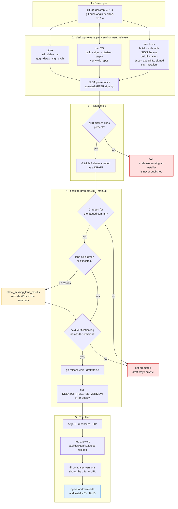

# How a desktop installer reaches a till

The path from a tag to an operator clicking **Install**. Five stages, two of them gates.

Signing itself is [`desktop-signing.md`](./desktop-signing.md); this is the order things happen in
and where it stops.



## The same thing in one column

```
  git tag desktop-v0.1.4
          |
          v
  +----------------------------------------------------------+
  |  desktop-release.yml        environment: release         |
  |                                                          |
  |  Windows            macOS              Linux             |
  |  build --no-bundle  build              build deb/rpm     |
  |  SIGN the exe       sign               gpg --detach-sign |
  |  build installers   notarise                             |
  |  assert still signed  staple                             |
  |  sign installers    verify via spctl                     |
  |                                                          |
  |  ... then SLSA provenance, AFTER signing                 |
  +----------------------------------------------------------+
          |
          v
   all 8 artifact kinds present? --- no --> FAIL, nothing published
          | yes
          v
   GitHub Release, as a DRAFT          <-- artifacts exist, nobody can get them
          |
          v
  +----------------------------------------------------------+
  |  desktop-promote.yml   (manual, FR-14.39)                |
  |    1. CI green for the tagged commit                     |
  |    2. every lane cell green or expected                  |
  |    3. field-verification log names this version          |
  +----------------------------------------------------------+
          | all three
          v
   gh release edit --draft=false
          |
          v
   DESKTOP_RELEASE_VERSION -> lgr-deploy configmap
          |
          v
   ArgoCD ~60s  ->  hub offers it  ->  till shows the offer
          |
          v
   operator downloads and installs BY HAND
```

## The parts that surprise people

**The Windows build runs twice, deliberately.** An installer is built by copying the app exe into
itself, so signing only the installers would leave an unsigned `LGR Desktop.exe` on every machine —
and that inner exe is what SmartScreen and AppLocker judge when the app is launched. ⚠ The
"assert exe still signed" step is load-bearing: cargo fingerprints its *inputs*, so the second
invocation normally leaves the signed binary alone. If that ever stops holding, cargo relinks, the
signature is silently gone, and the installers ship an unsigned exe while every later check passes.

**macOS is checked with `spctl`, not `codesign`.** ⚠ `codesign --verify` **passes on an app that
is signed but not notarised**, and such an app is refused on every customer Mac with a dialog
offering no way forward. Only Gatekeeper's own verdict separates them.

**A tag publishes a DRAFT.** The gate is a separate manual workflow, so the three conditions are
re-checked against the artefacts rather than trusted from the build that produced them.

⚠ **Condition 2 blocks the first release, and that is expected.** The vmtest lanes have never run —
no host — so no `lane-results*.tsv` is attached to the tag. `allow_missing_lane_results: true`
exists for exactly this, and its own description draws the line: *for a release whose lanes
genuinely cannot run, never for one whose lanes failed.*

**Nothing installs itself.** The till is told a newer version exists and where to get it; a human
installs it. `hand_to_installer` refuses by design until two anchors are pinned in the binary —
Tauri's updater minisign key and roomler's platform identity — because a downloader that cannot
verify what it runs is remote code execution on every machine in the fleet. For a per-machine MSI
install, IT-managed is the intended design anyway (FR-14, decided 2026-09-29).

⚠ **The fleet learns nothing until `DESKTOP_RELEASE_VERSION` is set.** It is the only thing that
tells the hub which desktop build is current: the hub and the shell are versioned separately, and
the hub cannot read releases from a private repository. Empty means "offer nothing", which is why
every till reported itself up to date for seven months (#93).

## Running it

```bash
# 1. tag  (the build host deploys what is on origin/master)
git tag desktop-v0.1.4 && git push origin desktop-v0.1.4

# 2. watch the build
gh run list --repo gjovanov/lgr --workflow desktop-release.yml --limit 1

# 3. promote, once the draft exists
gh workflow run desktop-promote.yml --repo gjovanov/lgr \
  -f tag=desktop-v0.1.4 \
  -f allow_missing_lane_results=true     # only while no lane host exists

# 4. prove the signing material without cutting a release
gh workflow run signing-smoke.yml --repo gjovanov/lgr
```

⚠ `lgr` is private: macOS minutes bill at **10×** and Windows at **2×**, and notarisation alone
takes minutes. A full release run is not cheap — see the matrix note in `desktop-ci.yml`.

## Related

- [`desktop-signing.md`](./desktop-signing.md) — the three identities, where they live, rotation
- [`desktop-install.md`](./desktop-install.md) — what an operator does with the installer
- `../../lgr-deploy/vmtest/README.md` — the lanes, and why they have never run
